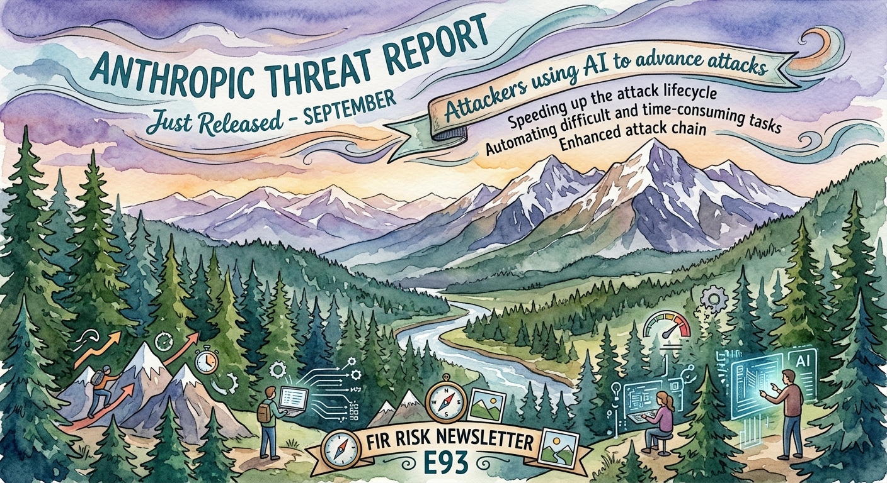

# FIR Risk Tuesday E93

**Publish Date:** October 13, 2026
**URL:** https://firrisk.ai/tuesday/e93-the-economics-changed/
**Sources:** [Anthropic — Detecting and countering misuse of AI: September 2026](https://www.anthropic.com/threat-intelligence-report-september-2026) · control response: [Anthropic — Developing Enterprise Frontier Safeguards with our customers](https://www.anthropic.com/news/enterprise-frontier-safeguards) · defender recommendations: [Anthropic Frontier Red Team — LLM ATT&CK Navigator](https://www.anthropic.com/research/attack-navigator) · threading: E92, INTEL-34 (GTG-1002), E90, E87
**Analysis:** FIR Risk Platform

---

# FIR Risk E93 — The Attacks Aren't New. The Economics Are.



FIR Risk Advisory | Enterprise Risk Intelligence

*Anthropic's September 2026 threat intelligence report documents eight months of disrupted AI misuse, and its central finding is not a new technique. It's a new cost structure: the reconnaissance, exploitation, tooling and data processing that once set elite operations apart now run as AI agents, at machine speed and in parallel. You don't need exotic new controls. You need the familiar ones to run at the attacker's speed, and your likelihood scores and your assumption that you're too small to target need to change.*

---

## What a frontier lab can see that you can't

Last November, Anthropic disclosed GTG-1002, the first documented campaign in which AI ran most of an espionage operation on its own. We covered how quickly that case became mainstream doctrine in [E92](/tuesday/e92-time-is-the-attack-surface/) and [INTEL-34](/intel/intel-34-doctrine-at-machine-speed/). Anthropic's new report, "Detecting and countering misuse of AI: September 2026," covers what came next: operations its Threat Intelligence team disrupted between December 2025 and August 2026, across seven harm areas from cyber operations and fraud to influence operations, surveillance and illicit model distillation.

Why read a vendor's report about its own platform? Because a frontier lab sees attacks at a stage no one else can: while they're being *built*. Breach reports tell you what happened after an intrusion. This one shows how intrusions are being assembled. That's an early-warning signal you can't get from your own telemetry, and Anthropic deserves credit for publishing it. This edition extracts what matters for risk and compliance leaders, and runs our usual check on what the report can't prove.

— Bruce, FIR Risk Advisory

---

## Bottom Line

In June we argued, from the Verizon DBIR, that AI was a *breadth* multiplier, not a *depth* multiplier ([E90](/tuesday/e90-refinement-not-revolution/)). Anthropic's report confirms the first half and escalates it. The techniques are still old: stolen credentials, unpatched edge devices, exposed services, SQL injection, phishing. What's new is that breadth now covers the expensive work. The reconnaissance, exploitation, tool development and data processing that once required a well-funded team are delegated to AI agents running at machine speed and in parallel.

**Same playbook, new cost structure: attacks on known, fixable weaknesses get more frequent, while the damage per incident doesn't shrink.**

---

## The One Sentence Your Board Needs

> Attackers aren't using new techniques; they're using AI to run familiar ones faster and more often, so the measure that matters now is how quickly we close known gaps.

A control that works on a 30-day cycle is not the same control when the attacker moves in hours. The question for the board isn't whether we have the right controls on paper. It's whether they operate fast enough to matter.

---

## 1. The labor that set elite attackers apart is now automated

The report's core finding, in its own words: "The attacks themselves are familiar." None of the operations depended on a technique defenders had never seen. What changed is who does the work.

The clearest example is a Russia state-nexus espionage actor Anthropic tracks as GTG-20006, whose attribution Anthropic says is consistent with public reporting on Midnight Blizzard. It hit more than 20 organizations, mostly in Ukraine and Europe: government ministries, defense and intelligence bodies, embassies, think tanks and defense companies. AI-driven workflows researched and registered phishing domains, sent the emails and monitored command-and-control channels. When security products detected its malware, monitoring agents modified and rebuilt the code to evade those detections. The human operators mostly adjusted the Claude Code skills that drove the workflows.

Criminal groups showed the same pattern. In one case involving operators Anthropic suspects are affiliates of the ShinyHunters collective, a single stolen developer token became full administrative control of a victim's cloud environment in roughly three hours, and one affiliate took data from roughly 200 of a SaaS company's downstream customer organizations.

**What it means for you:** in risk-register terms, *likelihood* rises for every known, fixable weakness you carry (stolen passwords, unpatched internet-facing devices, exposed services, phishing), because each attempt costs the attacker far less. *Impact* doesn't fall: the report says AI has increased criminal cyber activity in both scale and severity, so hold impact scores at least where they are. That's a concrete reason to re-score this quarter, not a vague worry about AI.

---

## 2. AI access is now the thing being stolen

Increasingly, attackers are going after AI itself. Anthropic reports that for multiple criminal groups, access to AI (compromised API keys, session tokens and devices) has become the sole objective, often sold on through brokers.

Two cases show how. GTG-50020 used production AI API keys stolen from customers' environments, then attacked roughly thirty AI companies in about four days trying to reach a pre-release Claude model. It found one working attack path and repeated it against all thirty targets, but every attempt to reach the model failed, and Anthropic says its own systems were not compromised. GTG-50021 ran a fake reseller offering cheap Claude access that was neither cheap nor actually Claude: it quietly routed buyers to another model and harvested their Anthropic account credentials for resale.

Anthropic's own advice to organizations is blunt: treat AI keys and agent integrations as seriously as production credentials, and buy AI access only through authorized channels.

**What it means for you:** your AI keys are now a target in their own right, and so is your AI supply chain. Ask every third-party AI tool, router and reseller where your traffic actually goes.

---

## 3. Marginal targets are now worth attacking

When reconnaissance and exploitation were expensive, it made sense for attackers to concentrate on high-value targets. Anthropic's report says AI autonomy makes previously marginal targets viable and encourages higher-volume, lower-touch operations. Our reading: an unpatched VPN appliance at a 200-person company is now an economic target, not an afterthought.

**What it means for you:** if your security budget rests on the assumption that you aren't interesting enough to attack, that assumption no longer holds. Your patch metrics need to show the worst-case exposure on internet-facing systems, not just the average, at every size of organization.

---

## 4. The lab's answer: checks and balances, if you hold up your end

Nine days before the threat report, Anthropic announced Enterprise Frontier Safeguards (EFS). It's the control model that matches the threat picture: Anthropic runs automated detection across sessions and accounts for offensive cyber activity, biological misuse, and stolen or leaked credentials, while the customer keeps the monitoring data in its own cloud, under its own keys, and reviews every flag with its own people. There's no Anthropic fee. Rollout is phased to eligible customers, with broad availability targeted for this fall.

It was shaped by more than 100 enterprises and the CISOs of the largest US banks, and in our view it addresses the right problem. Whether it works is not yet demonstrated: Anthropic hasn't published detection performance, flag thresholds or eligibility rules. And it moves accountability rather than removing it: Anthropic doesn't require any of its own staff to review an EFS alert. We cover it in [INTEL-36](/intel/intel-36-the-alarm-is-yours/), and our free [EFS Readiness Guide](/efs-readiness/) has the full checklist, including compensating controls for organizations that aren't eligible.

---

## The test we ran before we believed any of it

- **It's self-reported.** Anthropic is both the reporter and the platform, and claims like these can't be independently verified. We weigh it accordingly: the patterns match what Google's GTIG ([E79](/tuesday/e79-gtig-ai-threat-tracker/)) and Verizon's DBIR ([E90](/tuesday/e90-refinement-not-revolution/)) have reported, and the techniques described are well established.
- **Anthropic has an interest.** EFS is Anthropic's product, announced nine days before this report, and press coverage notes the company is preparing a public offering. A report showing serious threats and an announcement offering the safeguard serve it commercially. That doesn't make the findings wrong, but readers should weigh it.
- **It's the extreme end.** Anthropic stresses that these cases are the most notable and novel activity it found, not typical misuse. Read it as a view of where the frontier of attacker capability is, not of what the median attacker does today.
- **It's one provider's view.** Anthropic only sees what happens on its own platform. Attackers can and do use other models, so no single lab sees the whole picture, which is the strongest argument for every lab publishing at this level.
- **Defenses did work.** Not every case was a success for the attacker. GTG-50020 never reached the pre-release model it was after, and every operation in the report was eventually detected and disrupted.

None of that weakens the core finding. If anything, the fact that the techniques are old makes it more credible: nothing here requires believing in exotic new capabilities.

---

## So What Should Organizations Actually Do?

None of these are brand-new ideas. Most organizations already do some version of each. What changes is the speed and scope they need to run at. We've grouped them by when you can realistically act.

**Now: do these immediately**

1. **Find and lock down your AI keys.** Inventory every AI API key and account, move them into the vault you already use for production credentials, and rotate any you find in code, chat or shared files. Buy AI only through authorized channels.
2. **Re-score likelihood for known, fixable weaknesses.** These are stolen passwords, unpatched internet-facing devices like VPN gateways and firewalls, exposed services, and phishing. Raise their likelihood in your risk register. Don't lower impact: the report says scale and severity have both increased.
3. **Decide who owns AI alerts.** Before you have any monitoring in place, name who responds if your AI vendor tells you a key or account is being misused. If you're eligible, submit Anthropic's Enterprise Frontier Safeguards form so you're in the queue.

**Next: plan these over the next few quarters, in order of priority**

4. **Watch your own AI use.** You already monitor endpoints, identity and cloud. Add AI usage, spend and logs to that monitoring, with a triage playbook for misuse alerts, and review where third-party AI tools and resellers send your traffic.
5. **Shrink the worst-case exposure window.** You already track average patch time. Also report the *longest* exposure on internet-facing systems and known-exploited vulnerabilities, with a target in days, because an average can hide one device that's been open for two months.
6. **Enforce secure development, internally and with vendors.** You have the policies and contract clauses already. Add AI-assisted code review before release, and ask vendors for evidence, not attestation.

**Future: prepare now, act when you can**

7. **Adopt vendor-side safeguards as they arrive.** EFS isn't broadly available yet, and other AI vendors may follow with their own versions. Get your cloud storage, encryption keys and cleared reviewers ready, and ask every AI vendor what misuse alerts it can send you.
8. **Defend at machine speed.** The labor that's now cheap for attackers will be cheap for defenders too. Watch for AI tools that map your own attack surface and triage findings continuously, and for threat-sharing that moves at the same pace through your ISAC.

The threat report itself warns that AI "has inverted the cost back onto defenders": at least in theory, capable attackers can now bypass a new detection faster than defenders can build and deploy it. Anthropic's Frontier Red Team, in its June analysis of AI-enabled cyber threats, sets out the response. Defenders will need to use AI with the same sophistication and urgency as attackers, share threat intelligence, shorten the time from finding a vulnerability to patching it, and become much less tolerant of insecure code. It also says plainly that "the transitional period will be difficult," while arguing that capable AI should benefit defenders more than attackers in the long run.

That payoff isn't automatic. The transition will be hardest for organizations that wait, and the advantage goes to those who treat this moment as urgent.

---

## Learn More

- [Detecting and countering misuse of AI: September 2026 (Anthropic)](https://www.anthropic.com/threat-intelligence-report-september-2026) — Primary source
- [Mapping AI-enabled cyber threats: Insights from the LLM ATT&CK Navigator (Anthropic Frontier Red Team)](https://www.anthropic.com/research/attack-navigator) — Source of the defender recommendations (June 3, 2026)
- [Developing Enterprise Frontier Safeguards with our customers (Anthropic)](https://www.anthropic.com/news/enterprise-frontier-safeguards) — The EFS announcement
- [FIR Risk EFS Readiness Guide](/efs-readiness/) — Free availability status and readiness checklist
- [FIR Risk INTEL-36 — The Alarm Is Yours](/intel/intel-36-the-alarm-is-yours/) — The one action on EFS
- [Disrupting the first reported AI-orchestrated cyber espionage campaign (Anthropic)](https://www-cdn.anthropic.com/d7dd50dd1185f59be051b307150d877f2b82bd2c.pdf) — The November 2025 GTG-1002 disclosure
- [FIR Risk Tuesday E92 — Time Is the Attack Surface](/tuesday/e92-time-is-the-attack-surface/) — How GTG-1002 became doctrine
- [FIR Risk Tuesday E90 — Refinement, Not Revolution](/tuesday/e90-refinement-not-revolution/) — AI as a breadth multiplier, from the DBIR
- [FIR Risk Tuesday E87 — The Agents Have Keys](/tuesday/e87-the-agents-have-keys/) — When agentic AI got production access

---

Stay forward. Stay positive. Stay verified.

— FIR Risk Advisory

Find all editions on our Blog: https://firriskadvisory.com/blog/ · and on firrisk.ai: https://firrisk.ai/tuesday/

# LINKEDIN POST

```
Anthropic just published 154 pages on how attackers misused its AI over eight months. The most important line isn't about a new technique. It's this: "The attacks themselves are familiar."

Stolen passwords. Unpatched VPN gateways. Exposed services. Phishing. Nothing defenders haven't seen before.

What changed is the cost. The reconnaissance, exploitation, tool development and data processing that once took a well-funded team now run as AI agents, at machine speed and in parallel. In one case, a stolen developer token became full cloud admin control in roughly three hours.

For risk leaders, that changes three things:
→ Likelihood goes up for every known, fixable weakness you carry
→ "Too small to target" no longer holds
→ The measure that matters is how fast you close known gaps

This week's FIR Risk Tuesday breaks down what the report shows, what it can't prove, and what to do now, next and later.

Full breakdown in FIR Risk Tuesday E93.

#CyberSecurity #CISO #RiskManagement #AIGovernance #AISecurity #BoardGovernance
```

## X POST

Anthropic just published 154 pages on how attackers misused its AI over eight months. The most important line isn't about a new technique. It's this: "The attacks themselves are familiar."

Stolen passwords. Unpatched VPN gateways. Exposed services. Phishing. Nothing defenders haven't seen before.

What changed is the cost. The reconnaissance, exploitation, tool development and data processing that once took a well-funded team now run as AI agents, at machine speed and in parallel. In one case, a stolen developer token became full cloud admin control in roughly three hours.

For risk leaders, that changes three things:
→ Likelihood goes up for every known, fixable weakness you carry
→ "Too small to target" no longer holds
→ The measure that matters is how fast you close known gaps

This week's FIR Risk Tuesday breaks down what the report shows, what it can't prove, and what to do now, next and later.

Full breakdown → FIR Risk Tuesday E93

#CyberSecurity #RiskManagement

---

## SOURCE DATA

**Editorial Frame:**
E93 is a single-source synthesis of Anthropic's fourth public threat-intelligence report, written for enterprise risk leaders and compliance officers. The thesis comes straight from the report: the attacks are familiar, the economics have changed. It continues the agentic-AI thread from E87, E92 and INTEL-34 (GTG-1002) and escalates E90's "breadth, not depth" finding. EFS (announced nine days before the report) is covered as the lab-side control response and placed in context as one layer, not the answer. Board sentence revised to drop "our controls are still right": controls running on human-speed cycles are not the same control against machine-speed attackers.

**Primary Sources:**
- Anthropic — Detecting and countering misuse of AI: September 2026 (published Sept 10, 2026; 154-page PDF; activity disrupted Dec 2025 – Aug 2026). Read from the PDF; quotes and figures verified against it on Oct 11, 2026.
- Anthropic — Developing Enterprise Frontier Safeguards with our customers (Sept 1, 2026) and the EFS access form (claude.com/form/enterprise-frontier-safeguards)
- Anthropic Frontier Red Team — Mapping AI-enabled cyber threats: Insights from the LLM ATT&CK Navigator (June 3, 2026), source of the defender recommendations in the closing section
- Anthropic — GTG-1002 disclosure (Nov 2025), for continuity

**Methodology (this edition):**
Initial drafting relied partly on press coverage of the report; a line-by-line fact-check against the report PDF corrected several press-derived claims (below). The closing defender passage was first assumed to be from the threat report; a full-text search of the PDF showed it is not, and it was traced to the Frontier Red Team's June 3 post.

**Fact-Check Notes (verified against the report PDF, Oct 11, 2026):**
- CONFIRMED: "The attacks themselves are familiar…" passage verbatim, including "the economics of the attacks have changed" (Cyber section summary).
- CONFIRMED: activity disrupted Dec 2025 – Aug 2026; seven harm areas; Haiku/Sonnet/Opus used, no Fable/Mythos except one distillation case; "most notable and novel," not typical misuse; prior reports March, August, November 2025.
- CONFIRMED: GTG-20006 — attribution "consistent with public reporting linking the actor to Midnight Blizzard"; more than 20 organizations, concentrated in Ukraine and Europe; AI rebuilt detected malware; humans mainly modified the Claude Code skills driving the workflows.
- CONFIRMED: suspected ShinyHunters affiliates (GTG-50014) — single stolen developer token to full cloud admin in roughly three hours; roughly 200 downstream customer organizations of one SaaS provider.
- CONFIRMED: AI access "has increasingly become the sole objective of multiple criminal groups" (corrected from draft wording "primary objective").
- CORRECTED: GTG-50020 used production keys stolen from an AI vendor's evaluation sandbox (customers' keys) and attacked roughly thirty AI companies in about four days seeking a pre-release Claude model; every path failed; Anthropic's systems were not compromised. Draft had implied the keys were the target and the attack succeeded.
- CONFIRMED: GTG-50021 fake reseller — "neither cheap nor actually Claude"; harvested Anthropic credentials.
- CONFIRMED: "treat AI keys and agent integrations with the same level of seriousness…" and "AI access should be purchased only through authorized channels."
- CONFIRMED: autonomy leaves "potential payoffs largely unchanged" and "makes previously marginal targets viable."
- CONFIRMED: "AI has inverted the cost back onto defenders" (GTG-20006 section).
- REMOVED: claim that operators "split work across several AI providers so no single vendor sees the whole operation" — from press coverage, not stated as a finding in the report.
- REMOVED: Mandiant as corroboration — E85 covers attacker handoff speed, not AI misuse.
- RE-ATTRIBUTED: defender recommendations (use AI with the same urgency as attackers, share threat intel, shorten vulnerability-to-patch time, "much less tolerant of insecure code," "the transitional period will be difficult") — Frontier Red Team, June 3, 2026, not the threat report.
- EFS status as of Oct 11, 2026: phased rollout to eligible customers, broad availability targeted this fall, no GA announcement found. Re-check before publishing.

**FIR Risk Editorial Position:**
- Independence check named explicitly: self-reported, Anthropic's commercial interest (EFS launch, reported IPO), extreme-end cases, single-platform view, and that defenses worked (GTG-50020 failed; every operation disrupted).
- EFS framed as "addresses the right problem, not yet proven"; detection performance, thresholds and eligibility rules unpublished.
- Plain language over jargon: "known, fixable weaknesses" named explicitly instead of "commodity weaknesses."
- Actions avoid presenting existing practice as new (patch KPIs, secure development) and say what changes; grouped Now (immediate) / Next (next few quarters, by priority) / Future (prepare now, act when possible).
- No tables (newsletter, website and LinkedIn rendering).
- Voice: declarative, board-readable, incentive-aware.
