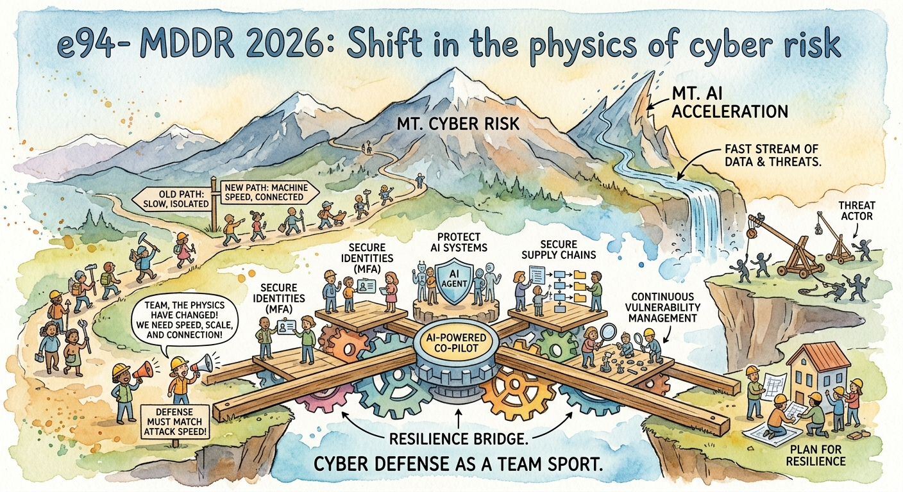

# FIR Risk Tuesday E94

**Publish Date:** October 20, 2026
**URL:** https://firrisk.ai/tuesday/e94-shift-in-the-physics-of-cyber-risk/
**Sources:** [Microsoft — Microsoft Digital Defense Report 2026: Decoding emergence](https://www.microsoft.com/en-us/security/security-insider/microsoft-digital-defense-report-2026) · threading: E73 (MDDR 2025), Best of E24 (MDDR 2024), E93, INTEL-36, E92
**Analysis:** FIR Risk Platform

---

# FIR Risk E94 — MDDR 2026: A Shift in the Physics of Cyber Risk



FIR Risk Advisory | Enterprise Risk Intelligence

*Microsoft says AI is "changing the physics of cybersecurity": it is reducing the time, expertise and cost required to find and exploit weaknesses. Its 2026 Digital Defense Report shows the result, an exposure window opening at both ends. Attackers turn new flaws into working exploits faster than most organizations can patch, and once inside they are staying hidden longer before anyone notices. In the middle sits a new kind of actor, the AI agent, which often has access but no owner. The answer for boards isn't another tool or a stricter deadline. It's direction on two things: the clock, meaning whether defenses are resourced and automated to keep pace with machine-speed attackers, and the owner, meaning a named person who answers for every AI agent and every exposed system.*

---

## A year on, Microsoft asks the board question itself

Last November, in [E73](/tuesday/e73-mddr-2025-summary/), we summarized the 2025 edition of Microsoft's Digital Defense Report with one line: treat cyber risk as business risk. The 2026 edition, "Decoding emergence," covers July 2025 through June 2026 and goes further. Its first takeaway is that "AI is changing the physics of cybersecurity," which Microsoft defines as AI "reducing the time, expertise, and cost required to discover and exploit weaknesses." Those three things used to slow attackers down. Its first priority for organizations is to "govern cyber risk at leadership level," and it frames the defining question for boards as "not whether disruption will occur, but whether the organization can continue operating, contain harm, recover quickly, and maintain trust when it does."

That is the question we've been asking since [E92](/tuesday/e92-time-is-the-attack-surface/), and it's a welcome one to see from the company with the largest sensor network in security. This edition pulls out what matters for CEOs, CFOs and risk leaders, compares it with the last two editions of the report, and runs our usual check on what the data can and can't tell you.

— Bruce, FIR Risk Advisory

---

## Bottom Line

The window an attacker can use is widening at both ends. At the front end, flaws are being weaponized faster than ordinary patch cycles can absorb. At the back end, intruders are going unnoticed for longer. And AI agents are arriving in the enterprise faster than anyone is assigning them owners.

**Attackers now work on a machine clock. Defense has to be resourced, prioritized and automated to keep up, and every agent needs a human who answers for it.**

---

## The One Sentence Your Board Needs

> AI has cut the time, skill and cost of attacking us. Are we resourcing and automating our defenses to keep pace, and does every AI agent we run have a named employee who answers for it?

Boards don't set patch deadlines; they set direction and priority. Microsoft's own report says reporting should move "from number of patches deployed to exposure reduced, detection coverage increased, and time-to-mitigate compressed." The board's job is to ask whether management is funding that shift, not to manage the patch queue.

---

## 1. The front end: weaponization outruns patch cycles

Microsoft's starkest number: "The median time from vulnerability discovery in the wild to weaponization has now collapsed to well below 24 hours." Vulnerabilities are on track for a record, an estimated 72,000 CVEs for 2026 (a projection, not a count).

Patching hasn't changed pace. Microsoft says median enterprise remediation for critical external vulnerabilities "can take 30–60 days," against the 7 to 14 days US federal agencies are required to meet for known-exploited flaws. For internet-exposed services, mass scanning "often starts within hours." Attackers also often get in before anyone knows there is a flaw: the Interlock ransomware group exploited a maximum-severity Cisco Secure FMC flaw for about 30 days before it was disclosed, and Microsoft says pre-disclosure windows of 30 days or more "are now routine."

The small-business angle is direct. In September 2025, Microsoft tracked a four-week surge in Akira ransomware across more than 50 organizations, mostly small and medium-sized businesses, all tied to one SonicWall VPN flaw.

Microsoft's conclusion is the right one, and it isn't "patch faster at all costs." It's that "the issue is no longer simply whether a patch exists, but whether organizations can identify exposed assets, prioritize the highest-risk flaws, and remediate them before attackers operationalize them." For internet-facing, identity and management systems, it says, "traditional monthly patch cycles may no longer be fast enough."

**What it means for you:** patching is hard, resource-hungry work, and a deadline from the boardroom doesn't make it faster. What does is knowing what you have exposed, ranking it by risk, and automating the routine fixes so people can focus on the hard ones. That's a funding and priority decision, which makes it a board-level one. Speed alone can't close the gap anyway: Verizon's 2026 DBIR found 29% of known-exploited vulnerabilities were attacked before they were even publicly disclosed ([E90](/tuesday/e90-refinement-not-revolution/)). That's why Microsoft pairs fast fixes with two moves that cover what patching can't: removing or isolating exposure you don't need, and looking back 90 days for signs of earlier exploitation.

---

## 2. The back end: intruders are staying longer

The second clock runs after the break-in. Comparing two years of its incident response engagements, Microsoft found "a statistically significant increase in dwell time" (the time from an intruder's first activity to its detection), while the overall length of attacker activity stayed broadly stable. In plain terms, attackers weren't staying longer because they wanted to. Organizations were taking longer to notice. The biggest increase was in industrials and manufacturing.

Microsoft doesn't put a number on it, but Mandiant does, from a different set of investigations. M-Trends 2026 reported that global median dwell time rose to 14 days from 11 in 2025, the first increase since Mandiant began tracking in 2010 ([E85](/tuesday/e85-responders-report/)). Two incident response teams, two datasets, same direction.

**What it means for you:** prevention gets the budget, but detection is where this year's data is slipping. How long an intruder could go unnoticed is a resilience measure, and it belongs in the same conversation as recovery readiness.

---

## 3. How they get in: the conversation, not the link

The report's year-over-year view of initial access in its incident response findings shows a sharp turn. Phishing rose from 7% to 23% of incidents, and exploitation of public-facing applications from 15% to 24%.

Two newer patterns matter most for finance teams:

- **Teams voice phishing.** Weekly confirmed malicious voice phishing over cross-tenant Microsoft Teams calls is up 502% from a year earlier. In the attacks Microsoft studied, 93% of attackers succeeded at least once in keeping a target on the line for 20 seconds or longer, and 30% of calls lasted beyond a minute. Once a call succeeds, attackers typically talk the victim into installing a remote-access tool and complete reconnaissance "in two minutes or less."
- **Business contact impersonation (BCI).** Microsoft is retiring the catch-all "BEC" label for impersonation scams and calling them BCI. It detected more than 46 million BCI attacks in 12 months. The share of first messages that asked for money or documents fell from 17% in October 2025 to 3% by June 2026. In Microsoft's words, "BCI is, overwhelmingly, a conversation starter. The fraud comes later." Payroll diversion attempts cluster at the start of the week: 51% land on a Monday or Tuesday.

**What it means for you:** the first email asks for nothing, so inbox filters have nothing to catch. The control has to sit where the money moves: at the bank-detail change, the payroll change and the remote-access request.

---

## 4. The new actor: agents without owners

In Microsoft's telemetry from AI workloads on Azure over a 90-day window, four techniques accounted for roughly 90% of observed attack activity: malicious link injection through model and tool outputs (52%), jailbreak and safety-bypass attempts (16%), tool and agent abuse (12%) and identity and credential abuse (10%).

The report names three risks as organizations adopt agents: ungoverned proliferation, where agent identities multiply faster than anyone tracks them; overprivileged access that is rarely revoked; and no human accountability. Its rule is the clearest sentence in the report: "No environment should ever have an agent without a human to answer for it."

AI browsers are the other new front. Microsoft sees them in daily use at more than 40% of organizations in its dataset. In a May 2026 analysis, AI browsers were the initial infection vector in incidents involving 57 distinct malware families, and a malicious extension campaign reached about 900,000 installs across more than 20,000 enterprise tenants, harvesting AI chat histories, prompts and session data.

This is the same conclusion Anthropic reached from the other side of the table in [E93](/tuesday/e93-the-economics-changed/) and [INTEL-36](/intel/intel-36-the-alarm-is-yours/): the AI vendor can raise the alarm, but accountability stays with you.

**What it means for you:** the board question is simple and answerable: do we have a named employee owner for 100% of our AI agents? If management can't say yes, or can't say how many agents there are, that's the finding.

---

## 5. Microsoft isn't the only one seeing this

We put the Microsoft findings next to the three other major reports we've covered this year: Verizon's 2026 DBIR ([E90](/tuesday/e90-refinement-not-revolution/)), Mandiant's M-Trends 2026 ([E85](/tuesday/e85-responders-report/)) and Anthropic's September 2026 threat report ([E93](/tuesday/e93-the-economics-changed/)).

**Where they agree:**

- **Exploited flaws are the main way in.** Verizon ranks vulnerability exploitation first for the first time (31% of breaches with a known entry point). Mandiant has had exploits at #1 for six straight years (32%). Microsoft's incident response data shows public-facing exploitation rising from 15% to 24%.
- **Fixing isn't keeping up.** Verizon found organizations fully remediated only 26% of critical known-exploited vulnerabilities, down from 38%, with a median of 43 days to resolve one. Microsoft says enterprise remediation can take 30 to 60 days.
- **The same flaw serves spies and extortionists.** Microsoft and Mandiant both document the July 2025 on-premises SharePoint attacks being used for state espionage and, within days, for Warlock ransomware. One unpatched server can become either a data-theft disclosure or a business shutdown, and you won't know in advance which.
- **The phone is the new inbox.** Mandiant found voice phishing was the #2 way in (11%), while Microsoft's Teams voice phishing rose 502%.
- **AI is an accelerant, not a new weapon.** Verizon found fewer than 1% of 793 AI-using threat actors reached high or critical capability. Anthropic found that the attacks are familiar and the economics changed. Microsoft's new contribution is the governance gap: agents with access and no owner.

**Where they seem to disagree, and why:**

- **Phishing.** Microsoft's incident response data has phishing rising from 7% to 23%. Mandiant has email phishing falling to 6%. Different case populations and different definitions (Microsoft counts "social engineering" separately), so neither number means "phishing is solved" or "phishing is back."
- **Third parties.** Verizon says third parties are involved in 48% of breaches, up 60%. Microsoft counts supply chain and trusted-relationship compromise as an *entry point* and gets 4% each, up from 2%. One measures involvement, the other the front door; both are rising.

## 6. What changed in a year

Microsoft now compares each edition with the last, so these are like-for-like. Beyond the Teams and dwell-time shifts above:

- **ClickFix came back.** These fake "verify you are human" attacks were 47% of observed initial access last year (our [E73](/tuesday/e73-mddr-2025-summary/) lead). Their share fell to 12.8%, but volume grew roughly 23x between December and May.
- **Ransomware grew.** Attacks reaching the ransom stage against enterprises rose 15.8%.
- **The basics work.** Password attacks fell 26%, which Microsoft calls "strong evidence" that MFA and passkeys are forcing attackers elsewhere.

Last year we summarized Microsoft's message as treating cyber risk as business risk. This year it asks leaders to govern it directly, with dwell time and agent permissions added to what they see.

---

## The test we ran before we believed any of it

- **Whose data it is.** Microsoft's figures come from its own customers and telemetry, and the incident response numbers from organizations that called Microsoft for help. That's an enormous view, not a representative sample.
- **Different datasets give different answers.** Public-facing exploitation is 24% of incident response findings but 4.8% of intrusions in Microsoft's wider threat telemetry. Exploit timing is "well below 24 hours" from discovery to weaponization, "single-digit days" from disclosure to exploitation, and "about five days" median time-to-exploit in outside research the report cites. They measure different things, so we quote each with its own definition rather than blending them.
- **Some shifts may be relabeling.** In the initial-access table, "phishing" rose sharply while "social engineering" and "none identified" fell. Part of the change may be better attribution and classification rather than attacker behavior.
- **The dwell-time finding has no headline number.** Microsoft shows it as box plots by sector and states the increase is statistically significant, but doesn't publish a median. We say "increased," and use Mandiant's 14-day median only as Mandiant's figure.
- **Projections are projections.** 72,000 CVEs is an estimate for the full year.
- **Microsoft has an interest.** It sells the integrated, cross-signal defense it recommends. It also deserves credit for candor: it names its own SharePoint Server as the most frequently exploited product in its data.

What holds regardless: how well patching is resourced, how long intruders go unnoticed and who owns each agent can all be measured inside your own organization, whoever's data you trust.

---

## So What Should Organizations Actually Do?

Most organizations already do some version of each of these. What changes is the priority and the resourcing.

**Now: do these immediately**

1. **Answer the ownership question.** Inventory your AI agents and name an employee sponsor for each one. When a sponsor changes roles, ownership transfers, and agents with no owner are switched off.
2. **Protect the payment change, not just the inbox.** Require a call back to a known number for any change to bank details or payroll deposits, with extra care early in the week.
3. **Close the Teams side door.** Limit external Teams calling to approved partners, keep the "External" warnings on, and restrict remote-access tools to IT.

**Next: plan these over the next few quarters, in order of priority**

4. **Fund and automate patch management.** Give the CISO the resources to know what's exposed, rank it by risk (internet-facing, identity and management systems first) and automate routine fixes. That starts with a complete inventory of internet-facing systems, remote-management tools and older devices, and isolating what can't be patched. Microsoft's own technical guidance is to fix newly identified vulnerabilities on internet-facing or identity systems within 72 hours, and to review the previous 90 days for signs of earlier exploitation. That's a target for the security team to work toward, not a board mandate.
5. **Change what gets reported.** Move from patches deployed to exposure reduced, detection coverage and time to contain, and add dwell time and agent permissions to the leadership view.
6. **Govern AI browsers and extensions.** Decide which are approved, block the rest, and watch for extensions that read AI chats.

**Future: prepare now, act when you can**

7. **Rehearse the bad day.** Run an assume-breach exercise that includes an AI agent acting outside its purpose, and test whether you can contain it, recover and keep operating.
8. **Start the long-horizon inventory.** Microsoft's tenth priority is a cryptographic inventory and post-quantum planning alongside AI governance. It isn't urgent this quarter, but it's cheaper to start than to rush.

Microsoft frames the goal as engineering "for endurance." We'd put it in a board's terms: accept that the attacker's clock is now a machine's, fund the defenses that can keep pace, and make sure every agent acting on your behalf has a person behind it.

---

## Learn More

- [Microsoft Digital Defense Report 2026: Decoding emergence (Microsoft)](https://www.microsoft.com/en-us/security/security-insider/microsoft-digital-defense-report-2026) — Primary source
- [FIR Risk Tuesday E73 — MDDR 2025 Summary](/tuesday/e73-mddr-2025-summary/) — Last year's edition
- [FIR Risk Best of E24 — Microsoft Digital Defense Report 2024](/tuesday/best-of-e24-microsoft-digital-defense-report-2024/) — The 2024 edition
- [FIR Risk Tuesday E93 — The Attacks Aren't New. The Economics Are.](/tuesday/e93-the-economics-changed/) — Anthropic's view of AI-enabled attacks
- [FIR Risk INTEL-36 — The Alarm Is Yours](/intel/intel-36-the-alarm-is-yours/) — Accountability stays with you
- [FIR Risk Tuesday E92 — Time Is the Attack Surface](/tuesday/e92-time-is-the-attack-surface/) — The three-clocks thesis

---

Stay forward. Stay positive. Stay verified.

— FIR Risk Advisory

Find all editions on our Blog: https://firriskadvisory.com/blog/ · and on firrisk.ai: https://firrisk.ai/tuesday/

# LINKEDIN POST

```
Microsoft's 2026 Digital Defense Report describes an exposure window opening at both ends.

At the front: the median time from a flaw's discovery in the wild to a working exploit is now "well below 24 hours." Enterprise fixes for critical external flaws can still take 30 to 60 days.

At the back: intruders are going unnoticed longer. Microsoft's incident response data shows a statistically significant rise in dwell time.

In the middle: AI agents with access and no owner. Microsoft's rule is the clearest line in the report: "No environment should ever have an agent without a human to answer for it."

For finance teams, two more:
→ Teams voice phishing up 502% year over year
→ Impersonation scams whose first email asks for nothing. The fraud comes later.

Boards don't set patch deadlines. They set direction. Two questions worth asking:
→ Are we resourcing and automating our defenses to keep pace with machine-speed attackers?
→ Does every AI agent we run have a named employee who answers for it?

This week's FIR Risk Tuesday: what the report shows, how it changed from the last two years, what it can't prove, and what to do now, next and later.

#CyberSecurity #RiskManagement #BoardGovernance #AIGovernance #CFO #CISO
```

## X POST

Microsoft's 2026 Digital Defense Report: the exposure window is opening at both ends.

Weaponization: "well below 24 hours." Enterprise fixes: up to 30 to 60 days. Dwell time: up. And AI agents arriving with access but no owner.

Microsoft's rule: "No environment should ever have an agent without a human to answer for it."

Two board questions:
→ Are we resourcing and automating defenses to keep pace?
→ Does every AI agent have a named owner?

Full breakdown → FIR Risk Tuesday E94

#CyberSecurity #RiskManagement

---

## SOURCE DATA

**Editorial Frame:**
Title (Bruce, 10/15): "MDDR 2026: A Shift in the Physics of Cyber Risk." Microsoft's "physics" = time, expertise and cost to discover/exploit weaknesses (p10 verbatim; p5 and p8 restate it as compressing timelines, falling cost of sophisticated capability, agentic automation/autonomy). "Cyber risk" chosen over "cyber physics" to avoid confusion with "cyber-physical" (OT/ICS).
E94 is a single-source synthesis of the Microsoft Digital Defense Report 2026 ("Decoding emergence"; reporting period July 2025–June 2026, 103-page PDF), written for CEOs, CFOs and risk leaders. Thesis: the exposure window is widening at both ends (weaponization speed, dwell time) while agents arrive without owners; boards should give direction on the clock (resourced, prioritized, automated defense) and the owner (named human for every agent). It continues E73 (MDDR 2025) and Best of E24 (MDDR 2024) with a year-over-year section, and links to E93/INTEL-36 on accountability. Frontier/autonomy material (JADEPUFFER, the OpenAI agents/Hugging Face sandbox escape, Mythos/GPT-5.5 32-step test) deliberately held for E95, a multi-source agent edition. No Recorded Future content (Bruce, 10/15).

**Board framing rule (Bruce, 10/15):** boards set direction and priority; they don't mandate patch speed. Explain the risk (machine-speed attackers) and encourage resourcing and automation of patch management; ask the ownership question (100% of AI agents with a named employee owner). Microsoft's 72-hour guidance is presented as technical guidance for security teams, not a board mandate.

**Fact-Check Notes (verified against the MDDR 2026 PDF, Oct 15, 2026; PDF page numbers):**
- p2: reporting period July 2025–June 2026; YoY comparisons use July 2024–June 2025.
- p7: priority #1 "Govern cyber risk at leadership level. Report identity exposure, patch latency, agent permissions, critical dependencies, dwell time, and recovery readiness." Defining board question quoted verbatim. Priority #10 cryptographic inventory + post-quantum planning alongside AI governance. "engineer for endurance."
- p8: takeaway 8, "reporting metrics should shift from number of patches deployed to exposure reduced, detection coverage increased, and time-to-mitigate compressed."
- p14: "well below 24 hours"; "record-breaking estimated 72K" CVEs for 2026 (projection). JADEPUFFER, OpenAI/Hugging Face, Mythos/GPT-5.5 → E95.
- p23: four techniques ~90% of Azure AI workload attack activity (52/16/12/10; 90-day window, 2026); three agent risks; "No environment should ever have an agent without a human to answer for it."
- p27: AI browsers daily use >40% of orgs in dataset; May 2026 analysis, 57 distinct malware families; extension campaign "more than 900,000 installs" in one passage and "nearly 900,000" in another → "about 900,000"; >20,000 enterprise tenants.
- p33: initial access YoY (2025→2026), source Microsoft Threat Intelligence, "incident response (IR) findings": None identified 25→14, Valid accounts 17→13, Exploit public-facing 15→24, Social engineering 15→7, Phishing 7→23. CORRECTED from outline: source is Microsoft Threat Intelligence IR findings, not labeled DART.
- p35: DART YoY: "statistically significant increase in dwell time," length of activity "broadly stable"; largest dwell increase industrials and manufacturing. Box plots only; no median stated.
- p45: public-facing exploitation "4.8% of observed intrusions"; SharePoint Server most frequently exploited product.
- p46: Teams cross-tenant vishing weekly confirmed malicious volume +502% YoY; 93% of attackers kept a target on the line ≥20s at least once; 48% of calls >20s; 30% >1 minute.
- p47: recon "in two minutes or less" after RMM access; "single-digit days" disclosure-to-exploitation.
- p48: Akira surge Sept 2025, 50+ orgs mostly SMBs, CVE-2024-40766 SonicWall SSL VPN; Interlock exploited Cisco Secure FMC CVE-2026-20131 (CVSS 10.0) ~30 days pre-disclosure; "pre-disclosure windows of 30 days or more are now routine"; "median time-to-exploit of about five days" (research published 2025); KEV 7–14 days vs enterprise 30–60 days; "The issue is no longer simply whether a patch exists…" verbatim; "traditional monthly patch cycles may no longer be fast enough"; recommendations: 72 hours for internet-facing/identity systems, review previous 90 days.
- p50: BCI term introduced; >46 million BCI attacks in 12 months; 17% (Oct 2025) → 3% (June 2026); "BCI is, overwhelmingly, a conversation starter. The fraud comes later…"; payroll diversion 51% Monday/Tuesday.

**YoY section (§6), 10/15: built ONLY from MDDR 2026's own year-over-year comparisons** (prior-year PDFs not used; the FIR agent's prior-year question timed out at 240s):
- p44: "Last year, ClickFix-style attacks… represented 47% of observed initial access activity" (matches E73's 47%, Defender Experts); this year "only 12.8% of observed intrusions"; "rebounded explosively in early 2026, growing roughly 23x between December and May." Source: Microsoft Defender Experts.
- p46: Teams vishing +502% "from this time last year."
- p64: "password attacks are down 26% year-over-year. This provides strong evidence that… MFA and passkeys are forcing…" attackers to other areas (new-hire onboarding, account recovery).
- p76: Defender: Akira most active (22%, up 150% compared to 2025); Qilin 14% (up 111%); leak sites: Qilin 16.4%, +386%.
- p77: "15.8% increase year-on-year in ransom detonations against enterprises."
- E24 (2024) comparisons dropped: unverifiable without the 2024 PDF and not needed.

**FIR agent ingest answer (10/15), checked vs p48:** all MDDR figures it gave match p47–48. Attribution: "about five days" is cited research ("Research published in 2025"); the 30–60 day enterprise figure carries no citation on p48 or in References (p102–103) and is worded "can take 30–60 days" → draft wording corrected from "puts median… at". Added: mass scanning "often starts within hours"; inventory + isolate-if-unpatchable recommendations. NOT used: VulnCheck 28.96%/23.6% (secondary summaries, unverified); claim the ToolShell patch was incomplete (not in MDDR). SharePoint: Microsoft cites CVE-2025-49704/49706, Mandiant (E85) CVE-2025-53770/53771, so §5 says "the July 2025 on-premises SharePoint attacks," not "the same flaws."

**Cross-report section (§5), added 10/15 from a FIR Risk Platform agent comparison, verified against our own fact-checked editions:**
- DBIR 2026 (E90; dataset Nov 1, 2024 – Oct 31, 2025): exploitation #1 at 31% of breaches with known vector; KEV critical remediation 26% (from 38%), median 43 days; "29% of KEV vulnerabilities were attacked before public disclosure" (E90 fact-check, Year in Review p.109). Use "before public disclosure," NOT "before a patch existed" (agent wording, and E90's own social copy, are looser than the source). Third-party 48%, +60%. 793 AI-using actors, <1% high/critical.
- M-Trends 2026 (E85; 2025 investigations): exploits #1 for sixth year at 32%; email phishing 6% (22% in 2022), voice phishing 11% (#2); global median dwell 14 days from 11, first increase since 2010; SharePoint 2025 flaws used by PRC espionage and LOCKBIT.WARLOCK.
- Anthropic: use the September 2026 report via E93.
- AGENT ERRORS CORRECTED: (1) said Anthropic's Sept 2026 report couldn't be found and used August 2025 report figures (17 orgs, $500K), which are outdated and dropped; (2) called DBIR figures unverified (E90 verified them against the report); (3) said Mandiant gave no exploit percentage (32%) and no period (2025 investigations); (4) said Verizon/Mandiant "underplay" one-flaw/two-adversary risk. Mandiant documented the same SharePoint dual use, so it's presented as corroboration, not a Microsoft-only insight. Agent's SEC-materiality and insurance-notice inferences not used (not in any source).

**Pending before publish:**
- Board sentence: Bruce still refining.
- Hero image: images/e94-shift-in-the-physics-of-cyber-risk.jpg not yet created.
- Confirm the public MDDR 2026 landing-page URL.
