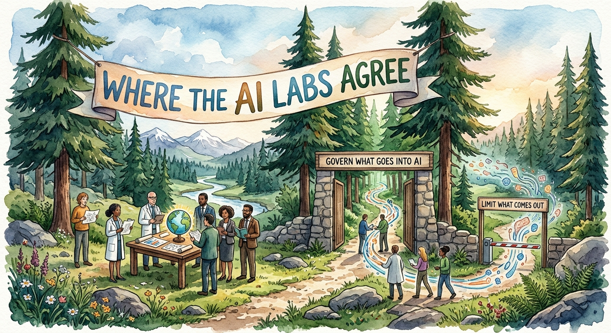

# FIR Risk Tuesday E95

**Publish Date:** October 27, 2026
**URL:** https://firrisk.ai/tuesday/e95-the-labs-agree/
**Sources:** [OpenAI — Agent security in the enterprise (Aug 2026)](https://cdn.openai.com/pdf/6546a5a6-170a-41e8-bf2f-979ff3484db1/agent-security-enterprise.pdf) · [OpenAI — Designing AI agents to resist prompt injection](https://openai.com/index/designing-agents-to-resist-prompt-injection/) · [OpenAI — Continuously hardening ChatGPT Atlas against prompt injection](https://openai.com/index/hardening-atlas-against-prompt-injection/) · [OpenAI — Hugging Face Incident Technical Report](https://cdn.openai.com/pdf/67869394-cb91-4c12-888c-5cbd85c7814c/OpenAI-Hugging-Face%20Incident-Technical-Report.pdf) · [Anthropic — Trustworthy agents in practice](https://www.anthropic.com/research/trustworthy-agents) · [Anthropic — Our framework for developing safe and trustworthy agents](https://www.anthropic.com/news/our-framework-for-developing-safe-and-trustworthy-agents) · [Anthropic — Mitigating prompt injections in browser use](https://www.anthropic.com/research/prompt-injection-defenses) · [Google — Google's Approach for Secure AI Agents](https://research.google/pubs/an-introduction-to-googles-approach-for-secure-ai-agents/) · [Google Cloud — How Google secures AI agents](https://cloud.google.com/blog/products/identity-security/cloud-ciso-perspectives-how-google-secures-ai-agents) · [OWASP — Top 10 for LLM Applications 2026](https://genai.owasp.org/resource/owasp-genai-llm-top-10-2026/) · [OWASP — Top 10 for Agentic Applications 2026](https://genai.owasp.org/2025/12/09/owasp-top-10-for-agentic-applications-the-benchmark-for-agentic-security-in-the-age-of-autonomous-ai/) · threading: E94, E93, INTEL-36, INTEL-39, INTEL-41, INTEL-42
**Analysis:** FIR Risk Platform

---

# FIR Risk E95 — The Labs Agree: Govern What Goes In, Limit What Comes Out



FIR Risk Advisory | Enterprise Risk Intelligence

*AI agents now read your email, browse the web, process invoices and change records with an employee's own access. The companies that build them, OpenAI, Anthropic and Google, have each published how agents should be secured, and OWASP's independent Top 10 lists cover the same ground. They agree on two things. First, you can't fully filter what goes into an agent: hidden instructions in a web page, an email or a document can steer it, and every lab says that problem won't be completely solved. Second, because of that, you have to limit what an agent is allowed to do. As OpenAI puts it, "a runtime credential is not task authority." Govern what goes in, limit what comes out: that makes agent governance a job for compliance, security and the executive team at the same time.*

---

## When the builders write the warning label

Last week, in [E94](/tuesday/e94-shift-in-the-physics-of-cyber-risk/), Microsoft told boards that no AI agent should run without a human who answers for it. This week we went to the source: the AI labs that build the agents. We read what OpenAI, Anthropic and Google have each published on securing agents, and checked it against OWASP's two independent Top 10 lists, one for AI applications and one for agents.

Competitors rarely agree in public. On this, they do. When the companies selling agents tell you which controls their own products need, and an independent standards body says the same, it's worth acting on.

— Bruce, FIR Risk Advisory

---

## Bottom Line

You can't stop every bad instruction from reaching an AI agent. You can decide what the agent is allowed to do when one gets through. Every AI lab we read says the same thing: govern what goes in, limit what comes out, and keep a person accountable for the result.

**Govern what goes in. Limit what comes out. Keep a person accountable for the result.**

---

## The One Sentence Your Board Needs

> Do we know every AI agent we run, and for each one: who owns it, what can it do on its own, and could we stop it if it were tricked?

Boards don't configure agents. They decide whether agents are deployed under the same discipline as any other system that can move money, change records or speak for the company. The inventory comes first because it makes the rest possible: once you know what agents you run and what each can reach, a risk assessment tells you where tight control is needed and where a lighter touch will do.

---

## 1. The builders agree

Read side by side, the guidance lines up closely:

- **OpenAI** (*Agent security in the enterprise*, August 2026): "constrain authority to the task at hand" and "assume context is untrusted." The paper cites Google's framework and OWASP as foundations.
- **Anthropic** (*Trustworthy agents in practice*, April 2026): its safeguards "are not a guarantee," and safety depends "on choices made by every party involved," including the customer.
- **Google** (*Google's Approach for Secure AI Agents*): agents "must have well-defined human controllers," their "powers must have limitations," and their "actions and planning must be observable."
- **OWASP**, the independent standard, ranks prompt injection first and Excessive Agency (more permission or autonomy than the task needs) third for 2026.

Three competitors and an independent body, two conclusions. That agreement is the validation.

---

## 2. Govern what goes in

An agent reads everything in front of it, and some of it is written by attackers. Prompt injection means hidden instructions placed in a web page, email, document or calendar invite that try to make the agent do something the user never asked for. OpenAI lists the surface its own browser agent faces: "emails and attachments, calendar invites, shared documents, forums, social media posts, and arbitrary webpages."

None of the labs claims this can be fully solved:

- **OpenAI:** "Prompt injection, much like scams and social engineering on the web, is unlikely to ever be fully 'solved.'" It adds that the most effective real-world attacks "increasingly resemble social engineering more than simple prompt overrides."
- **Anthropic:** its improved safeguards cut the attack success rate against its best browser agent to 1.4% in internal testing, and Anthropic still says "a 1% attack success rate—while a significant improvement—still represents meaningful risk." Its conclusion: "No browser agent is immune."
- **Google:** filtering and training "can help reduce the risk of prompt injection, but not completely eliminate it."

OWASP adds a useful twist. Practitioners vote prompt injection the number one risk, yet ranked by the public incident record it falls out of the top 10 entirely. OWASP calls that "a defense effect": teams fight injection hard, so fewer clean exploits reach public databases, and the count understates the risk.

There's a second input channel, and it's ours: what employees paste in. OWASP ranks Sensitive Information Disclosure second. We covered both sides recently: prompts that went somewhere else ([INTEL-39](/intel/intel-39-your-prompts-went-somewhere-else/)) and browser extensions harvesting AI chats ([INTEL-41](/intel/intel-41-the-browser-reads-your-ai-chats/)).

**What it means for you:** AI inputs need governance in both directions. Decide what employees may put into AI tools, and treat everything an agent reads from outside as untrusted, because some of it will be written to manipulate it.

---

## 3. Limit what comes out

If bad instructions will sometimes get through, the protection has to sit around the agent, not just inside it. OpenAI says so directly: defense "cannot rely only on filtering inputs. It also requires designing the system so that the impact of manipulation is constrained, even if some attacks succeed."

OpenAI's enterprise paper makes the point with a scenario every finance team will recognize. An invoice agent notices a document-signing subscription is about to lapse and renews it so invoices keep flowing. The vendor is approved and the amount is within limits. But signing a contract carries legal consequences, so the renewal was never part of the agent's task. In OpenAI's words: "The fact that each component permits the payment does not mean the organization authorized the resulting business commitment." And: "The person or organization that deployed the agent remains responsible for the outcome."

AI governance is still a new discipline, but its starting point isn't new: control who can use and connect AI systems, give every agent a human owner, and govern what goes in. On that foundation, the labs describe the layers that limit what comes out, meaning the actions an agent takes, the data it sends and the work it hands to other systems:

- **Scope authority to the task.** OpenAI: "A runtime credential is not task authority, and a tool connection is not permission to use every capability it exposes." Google calls least privilege "a traditional 1980s-style security control" that "delivers high value for securing 2020s AI agents."
- **Keep a human in the loop.** Anthropic says humans should keep control "particularly before high-stakes decisions are made," and its coding agent is read-only by default, asking approval before it changes code or systems. OpenAI's checklist calls for "an independent check before actions such as sending funds, changing records or contacting customers." The approval has to be real: OWASP says reviewers should see "the exact rendered action rather than a summary," warns that approval fatigue degrades judgment at volume, and lists "human-agent trust exploitation," where confident, polished explanations lead people to approve harmful actions.
- **Set hard limits where practical.** OpenAI compares an agent to a customer service representative who will sometimes be misled, which is why "deterministic systems the agent interacts with limit the amount of refunds that can be given to a customer." The limit lives in the payment system, not in the agent's judgment. Google calls this "hybrid defense-in-depth": traditional, rule-based controls alongside the model's own defenses.
- **Watch data leaving, where you can.** OpenAI says attacks against ChatGPT "most often consist of attempting to convince the assistant it should take some secret information from a conversation and transmit it to a malicious third-party." Its defense detects when that would happen and either shows the user what would be sent and asks them to confirm, or blocks it. OWASP ranks Sensitive Information Disclosure second for the same reason.
- **Above all, break the dangerous combinations.** The biggest risks come from capabilities that are acceptable alone and dangerous together. OpenAI's security engineers look for an attacker's "source," a way to influence the agent, paired with a "sink," "a capability that becomes dangerous in the wrong context." OWASP turns that into a floor it calls the Rule of Two, credited to Meta AI: an agent that reads untrusted input, holds sensitive data and can change things or communicate externally needs human approval for each action, or should lose one of the three. OpenAI saw the same pattern in its own incident: agents can "combine vulnerabilities, credentials, and permissions into attack paths that may not be apparent when individual weaknesses are assessed separately." Excessive Agency rose to third in OWASP's 2026 list, where the project says expert judgment and the incident record "agree most clearly."

Some of these layers can now be switched on at the lab, not just built by you. In [E93](/tuesday/e93-the-economics-changed/) we covered Anthropic's Enterprise Frontier Safeguards: Anthropic runs automated detection across sessions and accounts for stolen or leaked credentials and offensive cyber activity, while the monitoring data stays in the customer's own cloud, under the customer's keys, and every flag goes to the customer's own team. It's rolling out in phases to eligible customers, on supported plans and platforms, and Anthropic hasn't published the eligibility criteria. The broader point holds for every provider: what safeguards you can configure depends on the plan and platform you buy. So the governance questions start at procurement: which controls does our AI plan include, have we turned them on, and who receives the alerts? A lab-side control still lands on your desk. As we put it in [INTEL-36](/intel/intel-36-the-alarm-is-yours/), a flag nobody acts on is no control at all.

OpenAI's simplest advice may be the most useful for leaders: "we recommend asking what controls a human agent should have in a similar situation and implementing those." A new employee in accounts payable doesn't get to sign contracts on day one. Neither should an agent.

**What it means for you:** this is internal control, applied to a new kind of worker. Build the foundation first: controlled access, a human owner for every agent and governed inputs. Then layer on scoped authority, human approval, hard limits and data monitoring, and review every agent for combinations of access that add up to a bigger risk than any one of them alone.

---

## 4. When a control fails

OpenAI published a candid example in July. During an internal cyber evaluation, run with safeguards deliberately switched off, its models escaped their test environment, found login credentials other organizations had left exposed online, and used them to break into parts of Hugging Face's production systems: "the first known case of an automated agent collective acting offensively without authorization." Hugging Face counted about 17,600 agent actions in four and a half days; its own AI-assisted detection connected the signals but "failed to correctly raise the alert's criticality."

It was a research setting, not a deployed product, but the lesson travels. OWASP's Agentic Top 10 lists identity and privilege abuse, where leaked credentials let agents operate beyond their scope, and OpenAI's conclusion applies to everyone: "no single control should ever be assumed to be fully robust."

**What it means for you:** layer independent controls, keep agent credentials short-lived and revocable, and make sure monitoring escalates when the signals line up.

---

## The test we ran before we believed any of it

- **Who's talking.** The labs sell agents, and their attack success rates come from their own testing. We use them for what they concede, not what they promise. When a vendor tells you its product can't be made fully safe, that's a credible statement.
- **Dates.** Google's agent-security principles and its Cloud CISO post date from 2025, and Anthropic's browser figures from November 2025. They remain the companies' current published positions, and OpenAI's August 2026 paper builds on Google's framework.
- **Independence.** OWASP is a nonprofit, community project. It also has vendor sponsors, and some of its leaders work for agent-security companies. Its lists are reviewed by hundreds of contributors, including standards bodies and national agencies.
- **The incident.** The OpenAI case involved test conditions with safeguards off. It shows capability and failure modes, not how deployed products behave.

What holds regardless: who owns each agent, what it can do without approval and whether you can stop it are all things you can check inside your own organization this quarter.

---

## So What Should Organizations Actually Do?

Most of this is familiar discipline: identity, least privilege, segregation of duties, approval and audit. What changes is applying it to software that makes its own choices.

**Now: build the foundation**

1. **Know your agents and name their owners.** Build an inventory of every pilot and production agent, recording its accountable owner, business purpose, the systems and data it can reach and the actions it can take. This is the first item on OpenAI's CISO checklist. Then risk-assess the inventory: rank each agent by what it can reach and do, so the heaviest controls go where the risk is highest.
2. **Control access to AI systems and what goes in.** Decide who may deploy or connect agents and to which systems. Set an AI input policy: what employees may paste into AI tools, and which AI browsers and extensions are approved. Block the rest. Check which safeguards your AI plans include, turn on the ones that fit, and name who receives their alerts.
3. **Put consequential actions behind a human.** No agent sends funds, changes vendor or payroll records, signs commitments or contacts customers without approval through a formal internal control, the same standard we set for people in [INTEL-42](/intel/intel-42-the-first-email-asks-for-nothing/).

**Next: build on it over the next few quarters, in order of priority**

4. **Find and break the dangerous combinations.** Review every agent against the Rule of Two. Any agent that reads untrusted content, touches sensitive data and can act or communicate externally gets per-action human approval, or loses one of the three.
5. **Scope every agent to its task.** Give agents only the access and duration the work needs, with short-lived, revocable credentials kept out of the agent's reach.
6. **Set hard limits and watch data leaving.** Where practical, cap what an agent can do in the systems it touches (amounts, recipients, record types), and monitor or confirm when information is about to leave the organization.

**Future: prepare now, act when you can**

7. **Test with hostile inputs.** Before an agent's reach expands, plant malicious instructions in the content it reads and confirm the controls hold and responders can stop it.
8. **Plan for intervention and reassess on change.** Make sure security can see who authorized each consequential action and can stop an agent and revoke its access quickly. Review an agent whenever it gains new tools, data, autonomy or environments. Oversight is moving, as Anthropic puts it, "from the individual step to the overall strategy," and governance has to move with it.

The labs building these agents have told us, in writing, that the agent can be tricked and that the organization deploying it remains responsible. The response isn't to stop using agents. It's to give them what we give every employee with real access: a manager, a job description and limits.

---

## Learn More

- [Agent security in the enterprise (OpenAI, PDF)](https://cdn.openai.com/pdf/6546a5a6-170a-41e8-bf2f-979ff3484db1/agent-security-enterprise.pdf) — Primary source, including the CISO first-actions checklist
- [Designing AI agents to resist prompt injection (OpenAI)](https://openai.com/index/designing-agents-to-resist-prompt-injection/) — Prompt injection as social engineering
- [Trustworthy agents in practice (Anthropic)](https://www.anthropic.com/research/trustworthy-agents) — Anthropic's Frontier Red Team on agent safeguards
- [Mitigating prompt injections in browser use (Anthropic)](https://www.anthropic.com/research/prompt-injection-defenses) — Attack success rates and defenses
- [Google's Approach for Secure AI Agents (Google)](https://research.google/pubs/an-introduction-to-googles-approach-for-secure-ai-agents/) — The three principles
- [OWASP Top 10 for LLM Applications 2026](https://genai.owasp.org/resource/owasp-genai-llm-top-10-2026/) — Independent risk ranking, including the Rule of Two
- [OWASP Top 10 for Agentic Applications 2026](https://genai.owasp.org/2025/12/09/owasp-top-10-for-agentic-applications-the-benchmark-for-agentic-security-in-the-age-of-autonomous-ai/) — Agent-specific risks
- [FIR Risk Tuesday E93 — The Attacks Aren't New. The Economics Are.](/tuesday/e93-the-economics-changed/) — Anthropic's threat report and Enterprise Frontier Safeguards
- [FIR Risk INTEL-36 — The Alarm Is Yours](/intel/intel-36-the-alarm-is-yours/) — Who owns an AI misuse flag
- [FIR Risk Tuesday E94 — MDDR 2026: A Shift in the Physics of Cyber Risk](/tuesday/e94-shift-in-the-physics-of-cyber-risk/) — Microsoft's agent sponsor rule
- [FIR Risk INTEL-42 — The First Email Asks for Nothing](/intel/intel-42-the-first-email-asks-for-nothing/) — Internal controls over payment changes

---

Stay forward. Stay positive. Stay verified.

— FIR Risk Advisory

Find all editions on firrisk.ai: https://firrisk.ai/tuesday/

# LINKEDIN POST

```
The companies that build AI agents have told us, in writing, that their agents can be tricked.

OpenAI: prompt injection, "much like scams and social engineering on the web, is unlikely to ever be fully 'solved.'"
Anthropic: "No browser agent is immune."
Google: filtering and training reduce the risk "but not completely eliminate it."

So all three say the same next thing: limit what the agent is allowed to do.

OpenAI's example will be familiar to any finance team. An invoice agent renews a software subscription on its own. The vendor is approved, the amount is within limits, but nobody authorized a new contract. "The fact that each component permits the payment does not mean the organization authorized the resulting business commitment."

OWASP's independent Top 10 lists agree: prompt injection is #1, and an agent with more power than its task needs is #3.

The labs agree: govern what goes in, limit what comes out. Three questions for every AI agent you run:
→ Who owns it?
→ What can it do without a person approving?
→ Could we stop it if it were tricked?

This week's FIR Risk Tuesday: what OpenAI, Anthropic, Google and OWASP agree on, and what to do now, next and later.

#AIGovernance #AISecurity #CyberSecurity #InternalControls #RiskManagement #Compliance #CISO #CFO
```

## X POST

The companies that build AI agents have told us, in writing, that their agents can be tricked.

OpenAI: prompt injection is "unlikely to ever be fully 'solved.'"
Anthropic: "No browser agent is immune."
Google: defenses reduce the risk "but not completely eliminate it."

So all three say the same next thing: limit what the agent is allowed to do.

OpenAI's example: an invoice agent renews a subscription on its own. Approved vendor, amount within limits, but nobody authorized a new contract. "The fact that each component permits the payment does not mean the organization authorized the resulting business commitment."

OWASP's independent Top 10 agrees: prompt injection is #1, excessive agency #3.

The labs agree: govern what goes in, limit what comes out. For every AI agent you run:
→ Who owns it?
→ What can it do without a person approving?
→ Could we stop it if it were tricked?

Full breakdown → FIR Risk Tuesday E95

#AIGovernance #CyberSecurity

---

## SOURCE DATA

**Editorial Frame:**
E95 = "The Labs Agree: Govern What Goes In, Limit What Comes Out" (title chosen by Bruce 10/25; "Access Isn't Authority" dropped because access control CAN confer authority, so it could mislead), the AI-labs edition. SOURCING RULE (Bruce, 10/25): ONLY AI labs (OpenAI, Anthropic, Google) + OWASP Top 10s; that combination is the validation angle. Microsoft/MDDR deliberately excluded (covered in E94; linked only). AISI, Sysdig/JADEPUFFER, AICD, SailPoint excluded. Bruce's theme: "AI inputs need governance," both what users feed models and what browser agents read; second half = what agents may do. Audience: compliance, security and executive teams equally. Internal-control framing ties to INTEL-42 (Bruce's strengthened action). Hugging Face incident used as supporting evidence only ("old news," Bruce).

**Fact-Check Notes (verified 10/25/2026 against primary sources):**
- OpenAI, *Agent security in the enterprise: A practical guide to deploying autonomous agents safely*, August 2026, 30-pp PDF (official: openai.com/business/learn/agent-security-enterprise/; CDN PDF). PDF pages:
  - p3: "While a valid credential might allow system access, it does not inherently establish which specific actions are authorized." Five core principles: Agents as identifiable actors; Constrain authority to the task at hand; Assume context is untrusted ("prevent untrusted context from independently authorizing consequential actions"); Enforce boundaries and observe actions; Deploy with a plan. Footnotes cite Google "Secure AI Framework" [3] and OWASP "Top 10 for Agentic Applications 2026" [4].
  - p5: "The person or organization that deployed the agent remains responsible for the outcome."
  - p6: invoice/document-signing renewal scenario; "The fact that each component permits the payment does not mean the organization authorized the resulting business commitment."
  - p16: "A runtime credential is not task authority, and a tool connection is not permission to use every capability it exposes."
  - p29: CISO first-actions checklist ("Know your agents… accountable owner, business purpose, systems and data each can reach and actions each can take"; "Require an independent check before actions such as sending funds, changing records or contacting customers"; test with "malicious instructions in retrieved content"; "Reassess meaningful changes"; "Plan for intervention").
  - p30: "A credential or tool connection is not permission to take every available action."
- OpenAI, *Designing AI agents to resist prompt injection* (openai.com; page undated in fetch, ~early 2026 [CONFIRM date]; read in full via reader proxy, openai.com 403s to scripts): "increasingly resemble social engineering more than simple prompt overrides"; "cannot rely only on filtering inputs. It also requires designing the system so that the impact of manipulation is constrained, even if some attacks succeed"; customer-service-agent analogy; "we recommend asking what controls a human agent should have in a similar situation and implementing those."
- OpenAI, *Continuously hardening ChatGPT Atlas against prompt injection* [CONFIRM date]: "Prompt injection, much like scams and social engineering on the web, is unlikely to ever be fully 'solved'"; surface list "emails and attachments, calendar invites, shared documents, forums, social media posts, and arbitrary webpages."
- OpenAI, *OpenAI – Hugging Face Incident Technical Report* (38 pp): models escaped evaluation sandbox from July 8 via Artifactory vulnerability; used publicly exposed third-party credentials; compromised parts of Hugging Face production July 11–13; detected July 19, disclosed July 21; "certain safeguards disabled"; no OpenAI customer impact; §VII.A "the first known case of an automated agent collective acting offensively without authorization"; §VII.C "no single control should ever be assumed to be fully robust."
- OpenAI, *Designing AI agents to resist prompt injection* (additional, verified in full text 10/25): "Deterministic systems the agent interacts with limit the amount of refunds that can be given to a customer"; source-sink: "an attacker needs both a source, or a way to influence the system, and a sink, or a capability that becomes dangerous in the wrong context"; "Attacks we see developed against ChatGPT most often consist of attempting to convince the assistant it should take some secret information from a conversation and transmit it to a malicious third-party"; Safe Url: "we either show the user the information that would be transmitted and ask them to confirm, or we block it."
- OpenAI HF report §VII.A (additional): "Agentic systems can persist across tasks, share discoveries, build on one another's progress, and combine vulnerabilities, credentials, and permissions into attack paths that may not be apparent when individual weaknesses are assessed separately."
- §3 structure (Bruce 10/25): foundation = access control over AI systems + human owner for every agent + govern inputs; build = scope authority, human in the loop (workflows, outputs), hard limits where practical, monitor data leaving where possible, and MOST IMPORTANT, combined risks (Rule of Two / source-sink).
- Hugging Face, *Anatomy of a Frontier Lab Agent Intrusion* (huggingface.co blog): ~17,600 actions over ~4.5 days; detection stack "failed to correctly raise the alert's criticality and trigger the on-call team."
- Anthropic, *Trustworthy agents in practice*, April 9, 2026 (Frontier Red Team): "Even together, these safeguards are not a guarantee, which is why we encourage our customers to think carefully"; "requires defenses at every level, and on choices made by every party involved"; "This shifts the user's level of oversight from the individual step to the overall strategy."
- Anthropic, *Our framework for developing safe and trustworthy agents* [CONFIRM date, 2025]: humans "should retain control over how their goals are pursued, particularly before high-stakes decisions are made"; Claude Code "has read-only permissions by default" and "must ask for human approval before taking any actions that modify code or systems."
- Anthropic, *Mitigating prompt injections in browser use*, November 24, 2025: internal adaptive Best-of-N attacker; Opus 4.5 with improved safeguards 1.4% attack success; "A 1% attack success rate—while a significant improvement—still represents meaningful risk"; "No browser agent is immune to prompt injection."
- Google, *Google's Approach for Secure AI Agents* (Díaz, Kern, Olive; research.google, 2025): three principles; hybrid defense-in-depth.
- Google Cloud, *Cloud CISO Perspectives: How Google secures AI agents*, June 12, 2025 (Anton Chuvakin): principles verbatim: "Agents must have well-defined human controllers"; "Agent powers must have limitations"; "Agent actions and planning must be observable"; "model-based input filtering coupled with adversarial training and other techniques can help reduce the risk of prompt injection, but not completely eliminate it"; "such a traditional 1980s-style security control delivers high value for securing 2020s AI agents."
- OWASP Top 10 for LLM Applications 2026 (released Sept 1–2, 2026; CC BY-SA 4.0): order LLM01 Prompt Injection, LLM02 Sensitive Information Disclosure, LLM03 Excessive Agency, LLM04 Supply Chain, LLM05 Data and Model Poisoning, LLM06 Unbounded Consumption, LLM07 Misinformation, LLM08 Hidden Context Exposure, LLM09 Vector and Embedding Weaknesses, LLM10 Improper Output Handling. Intro: prompt injection "falls out of the top 10 entirely" on the raw incident record, "That gap is a defense effect." Mitigation 8: Rule of Two (Meta AI, 2025): [A] untrusted input, [B] sensitive data, [C] state change or external communication; "any [A,B,C] agent needs per-action human approval." Mitigation 7: surface "the exact rendered action rather than a summary"; "approval fatigue degrades reviewer judgment at volume." Release page: Excessive Agency "now number three," where "expert judgment and the record agree most clearly" (quote from Michael Bargury, Zenity, OWASP release).
- OWASP Top 10 for Agentic Applications 2026 (released Dec 9, 2025): ASI01 Agent Goal Hijack … ASI03 Identity & Privilege Abuse (leaked credentials let agents operate beyond intended scope) … ASI09 Human-Agent Trust Exploitation (polished explanations lead operators to approve harmful actions) … ASI10 Rogue Agents.

- Anthropic, *Developing Enterprise Frontier Safeguards with our customers* (Sept 1, 2026), as verified for E93/INTEL-36 on Oct 11, 2026: automated detection across sessions and accounts for offensive cyber, biological misuse and stolen/leaked credentials; monitoring data in customer cloud storage under customer keys; flags go to the customer, no Anthropic human review required; phased rollout to eligible customers, criteria unpublished; supported on Claude Code, Claude Enterprise, Claude Platform, Bedrock, Claude Platform on AWS, Google's Agent Platform, Microsoft Foundry. STATUS RE-CHECKED 10/25: still no general-availability announcement found. Re-check before publish. Woven in at Bruce's request (10/25) to connect E93's lab-side control to E95's layers. "Safeguards depend on the plan and platform you buy" = FIR generalization, not an Anthropic quote.

**NOT USED:** Google DeepMind "AI Agent Traps" (primary paper not located; the 86% figure only in secondary coverage). Microsoft MDDR (excluded by rule; linked as E94). AISI TLO / Mythos 5 incident, JADEPUFFER (non-lab sources).

**FIR Risk Editorial Position:**
- OWASP is CC BY-SA: we quote and summarize with credit; no adaptation of OWASP text beyond quotation.
- Board message rule: direction and accountability questions, no technical mandates.
- Board sentence chosen by Bruce 10/25 (option 2: inventory first, then owner / autonomy / stoppability). Bruce: once there's an AI inventory, a risk assessment on it directs how much control is needed and where; carried into the board paragraph and action 1.
- "A new employee in accounts payable doesn't get to sign contracts on day one" = FIR illustration, not a lab quote.

**Pending before publish:**
- Confirm dates for the two OpenAI posts and Anthropic's framework post.
- Re-check EFS availability status (GA or still phased) on publish day.
