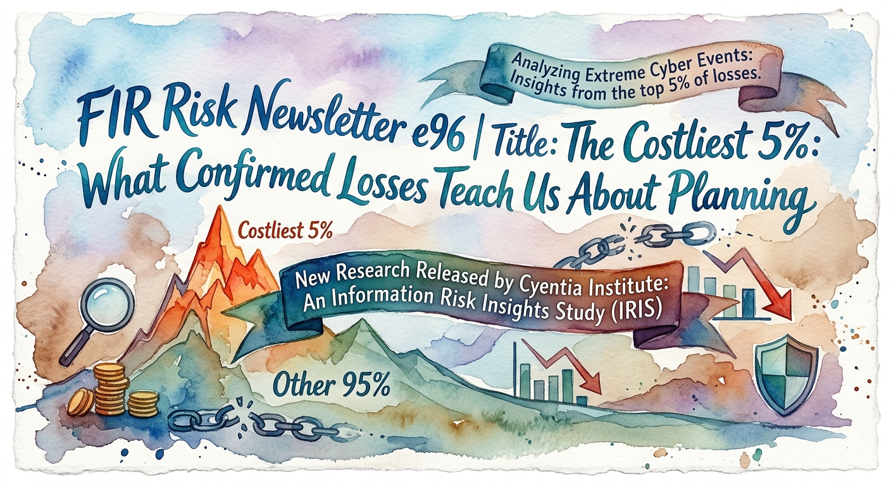

# FIR Risk Tuesday E96

**Publish Date:** November 3, 2026
**URL:** https://firrisk.ai/tuesday/e96-the-costliest-five-percent/
**Sources:** [Cyentia Institute — IRIS Xtreme 2026: An Information Risk Insights Study on Extreme Cyber Events](https://www.cyentia.com/iris) · threading: E90 (2026 Verizon DBIR), E85 (Mandiant M-Trends 2026), E59 (IRIS 2025)
**Analysis:** FIR Risk Platform

---

# FIR Risk E96 — The Costliest 5%: What Confirmed Losses Teach Us About Planning



FIR Risk Advisory | Enterprise Risk Intelligence

*Most cyber risk research counts attacks. The Cyentia Institute's IRIS Xtreme 2026 counts what the worst ones actually cost. It studies the costliest 5% of publicly reported cyber incidents over five years: 136 confirmed events and $26.4 billion in documented losses, plus 205 incidents companies reported to the SEC. It is hindsight evidence, and the newest events date from early 2025, because the full cost of an attack takes a long time to become known. That is exactly what makes it useful: it shows where the money was really lost, so you can check your own risk assessment against outcomes rather than headlines.*

---

## Hindsight is the point

Most of what we cover on Tuesdays looks forward: how attackers are working now and what is changing. This week is different. Cyentia's study looks back at the most expensive cyber events on record and asks what they actually cost and why.

That makes it the right input for one specific job: the risk assessment. When a CFO asks how bad a bad year could be, or a board asks whether insurance limits are right, the answer should come from real outcomes, not from the last headline. We read the report with that job in mind, and checked its findings against the 2026 Verizon DBIR and Mandiant M-Trends to see whether the patterns have held since the data closed.

— Bruce, FIR Risk Advisory

---

## Bottom Line

The costliest cyber events are not bigger versions of everyday incidents. They are mostly disruption, plus direct theft of funds, rather than data theft, they usually run through stolen logins and trusted third-party access, and companies' own SEC disclosures say little about what they cost. Use this evidence to size your planning range and to check that your risk register covers the scenarios where the big losses actually land.

**Plan for the events that cost the most, not just the ones that happen most.**

---

## The One Sentence Your Board Needs

> Is our worst-case cyber loss estimate based on evidence from real events at companies our size, and are our insurance and reserves built around it?

Boards don't build loss models. They can ask whether the number the company plans around comes from evidence, and whether insurance and cash reserves match it. Cyentia's own test is simple: if your worst-case scenario is a few million dollars and you are a multi-billion-dollar company, you are probably off by an order of magnitude; if every scenario on your risk register is a billion-dollar loss, you are probably overstating it. Either way, insurance, reserves and security spending end up sized to the wrong number.

---

## 1. Read it as evidence, not a forecast

Three things to keep in mind before using any of these figures:

- **It covers the extreme tail only.** Cyentia defines an extreme event as one in the top 5% of losses, at least $32 million. These 136 events are not a picture of all cyber incidents, and most organizations will never suffer one.
- **It trails the present.** The study covers five years, with the newest events in early 2025. Cyentia notes the reporting lag that is inherent to cyber loss events, which is why the most recent quarters in its data are thin.
- **It is a lower bound.** Only publicly reported losses are counted, and mostly the direct ones. Cyentia says the true cost is likely higher.

Used that way, it answers questions a forecast can't: what the worst outcomes really cost, what kind of loss they were, and how attackers got in.

---

## 2. Size the plan to your company

The median extreme event now costs $100 million, double the $47 million in Cyentia's 2020 study. The 95th-percentile loss across all incidents has risen 19 times since 2008, to $281 million, adjusted for inflation. Cyentia's conclusion is the one we drew from its IRIS 2025 study in [E59](/tuesday/e59-iris-2025-risk-insights/): loss estimates have to be recalibrated regularly.

The most practical part of the report breaks the numbers down by company size. For the 95th percentile, the loss that only one incident in twenty exceeds:

- **Revenue under $100M:** $9.1 million (median incident $357,000)
- **$100M to $1B:** $12.3 million (median $466,700)
- **$1B to $10B:** $61.8 million (median $1.8 million)
- **Over $10B:** $266.2 million (median $2.2 million)

Losses don't scale with size. A $9 million loss is nearly 20% of revenue for a $50 million company, while $266 million is about 0.5% for a $50 billion one.

Cyentia also simulated the old risk-matrix question: one catastrophe or a thousand small cuts? For most organizations, it takes about seven years of smaller incidents to add up to one extreme event. Only for the very largest companies, over $100 billion in revenue, do the small losses overtake it within a few years. Cyentia's question for the budget follows: if security spending is 90% prevention and 10% resilience, does that match where the big losses land?

**What it means for you:** find your revenue band, compare it with your current worst-case scenario and your insurance limit, and set an upper and lower bound you can defend.

---

## 3. The big losses come from disruption

Across all incidents, about 91% are mainly data exposure. Among extreme events, that falls to 33%. Disruption rises from 8% to 43%, and fraud from under 1% to 24%. Most of that fraud is cryptocurrency theft: across the 43 crypto events, theft of funds was nearly all of the loss, while among the other extreme events it was 7% of losses. Strip out cryptocurrency theft, and business interruption and lost sales are the largest share of losses. Response and notification costs are the most frequently reported, but not the largest.

The impact also travels. Nearly half of extreme events (46%) spread into the victim's supply chain, accounting for 55% of losses, and Cyentia's earlier research found downstream companies can lose as much as the original victim. The pattern held after the data closed: the 2026 Verizon DBIR describes the Jaguar Land Rover ransomware attack, which halted production for five weeks, caused an estimated £1.9 billion in damages and rippled across about 5,000 downstream organizations.

**What it means for you:** if your risk register is mostly data-breach scenarios, add the ones the evidence points to: weeks of downtime in your own operations, and an outage at a supplier you depend on. Then check that your insurance covers business interruption at a level that matches, not just response costs.

---

## 4. Where attackers get in, and where the money goes

Across breaches of every size, exploited software is now the most common way in: 31% of breaches in the 2026 DBIR, and 32% in Mandiant's M-Trends 2026, its top method for the sixth year running. In the extreme tail, the picture changes:

- **Stolen logins** (valid accounts) were the way in for 58% of extreme events, and those events account for **91% of losses**, "$9 of every $10."
- **Trusted relationships**, access through a vendor or partner, appeared in only 20% of events but 65% of losses. Valid accounts and trusted relationships often appear together, which Cyentia calls "about as close to an invisible threat as one can get."
- **Third parties** directly caused only 2% of extreme events, but contributed indirectly to a third of them and half of all losses.
- **Exploited internet-facing applications** were involved in 87% of stolen records, and known vulnerabilities, most with patches available, in 61%.

These shares overlap because one event can involve several methods, so they describe the events stolen logins were part of, not dollars caused by logins alone.

The lesson for prioritizing is that the two main controls work on different parts of the risk. Keeping internet-facing systems patched reduces how often you are breached and how much data leaves. Protecting identity, especially vendor and remote access, reduces how much the worst events cost. The DBIR adds a practical signal: half of ransomware victims had a credential leak in the 95 days before the attack.

**What it means for you:** rank controls by the losses they prevent, not only by how often incidents occur. Third-party risk comes in two forms that need different responses: a vendor's login being misused calls for access control, while a shared provider going down calls for resilience and alternatives.

---

## 5. Calibrate from outcomes, not disclosures or headlines

Several common inputs to risk assessments turn out to be weak:

- **SEC disclosures.** Of 205 incidents reported on 8-K filings, companies judged only 6% material or likely material, and only 22 included any estimate of financial impact. There is little overlap between the incidents filed as material and the costliest events. Cyentia calls the 8-K record "as much a record of regulatory uncertainty as it is a record of genuine material risk." Where filings are useful is operational impact: 44% describe disruption to operations, outages, order fulfillment or production.
- **Reputation.** Brand damage appears as a loss in just three extreme events, and as a possibly material impact in two of the 205 SEC filings. Stock prices typically recover within about two weeks of an average incident, and credit downgrades are rare.
- **Cost per record.** The number of records stolen tells you almost nothing about the loss. Cyentia's regression line is nearly flat, predicting the same cost for a thousand records as for a billion.
- **Worst-case myths.** Cyentia calls the claim that "60% of companies go out of business after a breach" a myth that persists in the security community. Even among these extreme events, about 9% led to bankruptcy and near 7% to the company ceasing to exist: rare overall, though more likely at the extreme end.

**What it means for you:** use public disclosures for what they show well, operational impact, and use loss data like this to set the size of the risk.

---

## The test we ran before we believed any of it

- **Who's counting.** Cyentia builds on Zywave's loss database of more than 150,000 incidents, which insurers use to price cyber risk, plus Feedly threat intelligence and Board Cybersecurity's tracking of SEC filings. All of it is public-record data, so it shows only what was reported.
- **Crypto.** About a third of the extreme events (43 of 136) are cryptocurrency thefts. They skew some figures, especially losses compared with revenue, so we have used the non-crypto figures where Cyentia separates them.
- **Two different datasets.** The revenue-band figures in section 2 come from Cyentia's IRIS 2025 study of all incidents, not from the 136 extreme events.
- **Different scopes.** The DBIR counts breaches, Mandiant counts its own investigations, and IRIS counts the costliest events. We compare their direction, not their numbers.
- **Since the data closed.** The DBIR and M-Trends 2026 show exploitation, stolen credentials and third-party exposure all still prominent in 2025 activity. Nothing we read suggests the patterns in this study have reversed.

---

## So What Should Organizations Actually Do?

None of this calls for more fear or more tools. It calls for checking that the risk assessment matches the evidence.

**Now: check the numbers**

1. **Test your worst case against your size.** Compare your largest cyber scenario with the 95th-percentile loss for your revenue band. If it is far lower or far higher, find out why.
2. **Add disruption to the register.** Model a multi-week outage of your own operations and an outage at a critical supplier, alongside data breach.
3. **Put identity first for loss reduction.** Make sure remote and vendor access require strong multi-factor authentication, and that someone watches for leaked company credentials.

**Next: align spending and coverage over the next few quarters**

4. **Map third-party access and dependencies.** List which vendors can log in to your systems and which providers you could not operate without, and treat the two lists differently.
5. **Map insurance to the forms of loss.** Ask your broker to compare your coverage with where extreme losses land, especially business interruption limits and sublimits.
6. **Review the balance of prevention and resilience.** Ask whether recovery capability, insurance and cash reserves are sized for one extreme event, not just a steady run of small ones.

**Future: keep the evidence current**

7. **Recalibrate every year.** Loss data trails the present by a year or more, and the thresholds keep rising. Update your planning range as new studies arrive, and keep resourcing automated patching for internet-facing systems so the most common way in stays narrow.

The costliest 5% of cyber events have already happened to someone else. The best use of that hindsight is to make sure your plan would hold if one happened to you.

---

## Learn More

- [IRIS Xtreme 2026 (Cyentia Institute)](https://www.cyentia.com/iris) — Primary source: 136 extreme cyber events and 205 SEC 8-K incidents
- [FIR Risk Tuesday E59 — Cyentia Institute's 2025 Information Risk Insights Study](/tuesday/e59-iris-2025-risk-insights/) — The all-incident companion study
- [FIR Risk Tuesday E90 — Refinement, Not Revolution](/tuesday/e90-refinement-not-revolution/) — The 2026 Verizon DBIR, including third-party breaches
- [FIR Risk Tuesday E85 — The Responder's Report](/tuesday/e85-responders-report/) — Mandiant M-Trends 2026

---

Stay forward. Stay positive. Stay verified.

— FIR Risk Advisory

Find all editions on firrisk.ai: https://firrisk.ai/tuesday/

# LINKEDIN POST

```
Most cyber research counts attacks. Cyentia's IRIS Xtreme 2026 counts what the worst ones actually cost.

136 confirmed events. The costliest 5% of publicly reported incidents over five years. $26.4 billion in documented losses.

It's hindsight: the newest events are from early 2025, because the full cost of an attack takes time to surface. That's what makes it useful for one job, checking your risk assessment against real outcomes.

What the evidence says:
→ The big losses are mostly disruption, not data theft. Data exposure is 91% of all incidents but 33% of extreme ones.
→ Stolen logins were involved in events making up 91% of extreme losses. Vendor and partner access: 20% of events, 65% of losses.
→ 46% of extreme events spread into the supply chain.
→ Of 205 incidents filed with the SEC, companies called 6% material, and only 22 gave a cost estimate.
→ For companies under $100M in revenue, the 95th-percentile loss is $9.1M. For $100M to $1B, $12.3M.

The question for every board: is our worst-case cyber loss estimate based on evidence from companies our size, and are our insurance and reserves built around it?

This week's FIR Risk Tuesday: what the costliest 5% teach us about planning.

#CyberRisk #RiskManagement #RiskQuantification #CyberInsurance #ThirdPartyRisk #CISO #CFO #Boards
```

## X POST

Most cyber research counts attacks. Cyentia's IRIS Xtreme 2026 counts what the worst ones cost: 136 confirmed events, the costliest 5%, $26.4B in losses.

It's hindsight (newest events early 2025), and that's the point: check your risk assessment against real outcomes.

→ Big losses are mostly disruption, not data theft
→ Stolen logins tied to 91% of extreme losses
→ Vendor access: 20% of events, 65% of losses
→ Only 6% of SEC-filed incidents called material

Is your worst-case estimate built on evidence from companies your size?

Full breakdown → FIR Risk Tuesday E96

#CyberRisk #RiskManagement

---

## SOURCE DATA

**Editorial Frame:**
E96 = IRIS Xtreme 2026 (Cyentia), next edition before SIGNALS 2026 ships. Bruce's framing (10/31): NOT fear-based; optimization and staying current on risk evidence; make clear it is hindsight (cyber loss data trails ~18 months) and covers only the 5% most extreme PUBLICLY reported events, not all events; use it to inform the risk assessment process; keep the point that SEC disclosures aren't useful for understanding real risk. Agent questions (FIR platform, 10/31): Q1 initial access, Q2 third parties; both answers verified, see below.

**Wording guard (Bruce raised 10/31):** the report does NOT say extreme-event victims under-rated or under-disclosed their risk beforehand. It did not examine 10-K/10-Q risk disclosures (footnote 8, p22). Supported claims only: 6% material, 22/205 with loss estimates, little overlap material vs extreme, "record of regulatory uncertainty", reputation in 2/205. The "off by an order of magnitude" test (p32) is Cyentia's guidance, not a finding.

**Fact-Check Notes (verified 10/31/2026 against IRIS2026-Xtreme.pdf, 38 pp; PDF page = printed page):**
- p2: top 5% of losses over last five years; 136 extreme events; $26.4B documented losses; median $100M, double the last study; 95th pct risen 19-fold since 2008. Footnote 1: inflation-adjusted 2025 USD.
- p3 Key Findings: "Most 'material' cybersecurity incidents aren't material"; 205 incidents filed after the 2023 SEC rule; only 6% assessed as material; "little overlap between 'material' and 'extreme' events"; third parties directly 2%, indirectly a third of events and half of losses; "$9 of every $10 lost in extreme events tie to Valid Accounts"; patchable vulnerabilities behind 61% of stolen records.
- p4: extreme threshold = 95th pct of inflation-adjusted losses over last 15 years = at least $32M.
- p5 Table 1 (Source: IRIS 2025, all incidents) 50%/95%: >$10B $2.2M/$266.2M; $1B–10B $1.8M/$61.8M; $100M–1B $466.7K/$12.3M; <$100M $357.0K/$9.1M. "$9M loss for a $50M organization… nearly 20%"; "$266M loss for a $50B organization… 0.5%". Note: losses are direct/quantifiable, "conservative lower bound."
- p6: 2020 Xtreme median $47M → $100M; Fig 2: 95th $14.7M (2008) → $281.3M (19.1x); median $192.2K → $2.4M (12.6x).
- p7: 136 events over five-year period; Fig 3 quarterly counts end at 2025, "Ignore the dip at the end; that's due to the reporting lag that's inherent to cyber loss events." (Section 1 previously added "filings, lawsuits and insurance claims" — not in the source; removed 10/31.) Newest events ~early 2025 = FIR reading of Fig 3 (no stated cutoff); latest named case Co-op UK, April 2025 (p21).
- p8–9: Fig 4: "on average, it takes 7 years of 'minor cuts' to equal the damage caused by one 'critical hit'"; Fig 5: >$100B firms, "<3 years of smaller losses to exceed."
- p10: "If your security budget is 90% prevention and 10% resilience, does that match what this data is telling you?" Financial ~40% of extreme events.
- p11: crypto 43 of 136 (16 of 103 in 2020).
- p15 Fig 9 (overall → extreme, by count): exposure 91% → 32.8%; disruption 7.8% → 43%; fraud 0.9% → 24.1% (text: "under 40%", "over 43%", "27-fold").
- p16–17 Fig 11: records vs losses for extreme events; regression line "almost perfectly flat… same loss prediction for a breach of a thousand records as for a breach of a billion."
- p16 text after Fig 10: "a good chunk of those fraud events involve cryptocurrency theft" (no crypto split of Fig 9 given). p18 Table 2 financial theft & fraud: crypto 97.6% freq / 91.2% losses; non-crypto 18.1% / 6.9%. p28: scam/fraud pattern (BEC) "constricts at the extremes." Report does not analyze attacker motive (fraud = outcome category). Fraud wording tightened 10/31 at Bruce's request.
- p18 Table 2 (non-crypto freq / loss share): business interruptions & lost sales 29.2% / 20.4%; response & notification 45.8% / 17.8%; fines 33.3% / 10.0%; ransom 15.3% / 2.6%; brand 4.2% / 0.9%. Text: response "most commonly reported"; business interruptions "drive the largest share of actual losses."
- p19: brand or reputational damage "appears in just three incidents in the entire dataset." Fig 13: supply chain impact 46.4% (text: "over half (55%) of all associated losses"; Ripples research: downstream costs "can equal or even exceed"); government hearing 38.4%; bankruptcy 8.7%; extinction 6.5%; credit rating 2.9%; exec churn 2.2%. Text (p20): "Those numbers may seem small if you've heard the '60% of companies go out of business after a breach' myth that persists in the security community… going belly up after an incident is very rare in the grand scheme of things, but that risk is significantly elevated when we cross into extreme event territory." (Section 5 bullet now quotes the claim exactly; was paraphrased as "most companies close" — fixed 10/31.)
- p21: stock returns reverse "within roughly two weeks for the average incident"; credit downgrades rare (Hamilton, Co-op, MGM credit negative).
- p22–24: 205 incidents from Board Cybersecurity (34 Item 1.05, 33 Item 7.01, 145 Item 8.01); 22 of 205 with financial impact estimate; median reported loss $13.5M; "only 7 are currently assessed as material… with 5 more assessed as likely to be material… (6% of the total)"; footnote 8: 10-Q/10-K not integrated; "as much a record of regulatory uncertainty as it is a record of genuine material risk"; reputation "possibly material" in exactly 2 of 205; 91 of 205 (44%) confirmed operational impact; Fig 15 categories (business operations, system outages, order fulfillment, production output…).
- p25 Fig 16: external 94.9% of events / 86.0% of losses; internal 2.9% / 2.5%; third party 2.2% / 11.4%.
- p26 Fig 17: third parties indirectly 33% of incidents, 50% of losses.
- p29 Table 3 (freq / losses / records): valid accounts 58.1 / 91.0 / 39.3; exploit public-facing app 40.4 / 44.2 / 87.1; phishing 39.0 / 37.9 / 9.0; trusted relationship 19.9 / 64.9 / 21.6; external remote services 16.9 / 21.5 / 9.8; supply chain compromise 6.6 / 9.7 / 1.2. Multiple techniques per incident. Quote: "about as close to an invisible threat as one can get."
- p30 Fig 20: known CVE exploited 18% of incidents, 16% of losses, 61.4% of records; "most with available patches."
- p32–33 "Now What": "If your worst-case ransomware scenario is $5M and you're a multi-billion dollar company, you're off by an order of magnitude… if every scenario on your risk register produces a billion-dollar loss, you're likely catastrophizing"; insurance limits vs 95th pct; business interruption sublimits; capital reserves.
- Appendix A (p35): Zywave Cyber Loss Data (150,000+ incidents, used by (re)insurers), Feedly for Threat Intelligence, Board Cybersecurity Incident Tracker.

**Comparison sources (verified via FIR editions):**
- 2026 Verizon DBIR (E90, verified 6/2026): exploitation #1 initial access, 31% of breaches with known vector (p10); credential abuse 13%, phishing 16% (p10); third-party breaches up 60% to 48%; Jaguar Land Rover: five-week production halt, ~£1.9B, ~5,000 downstream entities; half of ransomware victims had a credential leak within 95 days before the attack.
- Mandiant M-Trends 2026 (E85): exploits #1 initial infection vector for the sixth consecutive year at 32%.
- FIR platform agent Q1 cited M-Trends 2025 (33/16/14) — superseded edition; NOT used.

**NOT USED:** "29% of extreme events exceeded annual revenue" (crypto-skewed). E59's "$2.9M median" (E59 rebuilt from LinkedIn, not primary-verified; conflicts with IRIS Xtreme's ~$535K–600K IRIS 2025 median; check E59 against the IRIS 2025 PDF separately). Crypto-specific sidebar (p13).

**FIR Risk Editorial Position:**
- Board message rule: question/direction only; no mandates. Patching framed as resourcing automation, not speed targets.
- No governance-route prescriptions.
- "Two forms of third-party risk need different responses" = FIR synthesis (prompted by the FIR agent's Q2 answer), not a Cyentia claim.

**Pending before publish:**
- Title and intro ("Hindsight is the point") approved by Bruce 10/31; hero image added 10/31.
- Candidate INTELs: (1) planning range by revenue band (drafted as INTEL-49, branch content/e96-intel); (2) disruption, not data theft; (3) logins vs exploits; (4) SEC 8-Ks as weak calibration.
