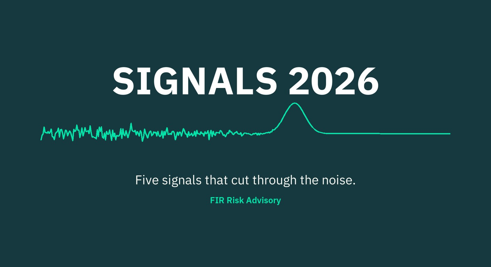

# FIR Risk Tuesday E98

**Publish Date:** November 17, 2026
**URL:** https://firrisk.ai/tuesday/e98-signals-2026/
**Sources:** FIR SIGNALS 2026 (https://firrisk.ai/reports/signals-2026/), built from 26 primary reports re-read, 19 cited, 43 figures checked at the source page · threading: E85–E97
**Analysis:** FIR Risk Advisory

---

# FIR Risk E98 — SIGNALS 2026: Five Signals That Cut Through the Noise



FIR Risk Advisory | Enterprise Risk Intelligence

*SIGNALS 2026, our annual report for CEOs and boards, is out. We put two years of FIR Risk editions side by side, went back to the original reports, checked every number at the source, and kept only what held up: five signals, each with one question for your next board meeting. You can read it, watch it or listen to it, free and with no registration, at firrisk.ai.*

---

## Why SIGNALS

Every year the security industry publishes hundreds of reports. Most are careful work, and each one makes the case that its problem is the biggest. For a CEO or a board, the result is noise.

Over the past two years, FIR Risk has published 100 editions analyzing the major reports, from Verizon, Microsoft, Mandiant, CrowdStrike, IBM, Anthropic and many others. This year we asked a different question: what survives when you put them all side by side?

SIGNALS is the answer. A finding made the cut only if independent sources agree on it, it has held for more than a year, and it matters to the decisions leaders make about priorities, funding and oversight. We went back to the original reports and checked all 43 figures. What didn't pass, we left out.

Thank you for reading FIR Risk this year.

— Bruce, FIR Risk Advisory

---

## Bottom Line

Attackers now move faster than any patch cycle, look like your own employees once they're inside, and increasingly come in through your vendors. Fewer victims pay ransoms, so the cost of an attack is now set by how long you're down. And the AI risk you can actually control is your own company's use of it. The good news: the basics still stop most attacks, and companies are catching more of them on their own.

**Five signals, five questions. None of them takes long to ask.**

---

## The One Sentence Your Board Needs

> Which basics are we not funding yet?

Ask it before the other five. More than 90% of breaches were enabled by gaps that were preventable, and multi-factor authentication still blocks more than 99% of unauthorized sign-ins. The fundamentals still decide most outcomes.

---

## The five signals

### 01 · The window is gone. Expose less.

Average eCrime breakout time, from first access to moving through the network, fell from **84 minutes in 2022 to 29 minutes in 2025**. The fastest was **27 seconds**. And **29%** of exploited flaws were attacked on or before the day they were published. You can't out-patch that. You can shrink what you expose.

> **Ask:** Do we know every system we expose to the internet and every open-source package we depend on, and is that footprint getting smaller?

### 02 · Inside, they look like you.

Logins are harder to break, so attackers talk their way in. Voice phishing is now the **#2** way in. Once inside, they act like real users: **82%** of the intrusions CrowdStrike detected in 2025 used no malware at all, just stolen logins and the tools your own staff use.

> **Ask:** If an attacker were logged in as one of our employees today, would we know?

### 03 · Half of breaches now involve a third party.

**48%** of breaches involved a vendor, partner or supplier, up from **9%** three editions ago. In one case, a single stolen token reached full control of a company's cloud in about **three hours**. Trusted relationships were the way in for **20%** of extreme cyber events, but **65%** of their losses.

> **Ask:** How many vendors do we rely on, and how many of the critical ones have a current risk assessment?

### 04 · Recovery time sets the bill.

**69%** of ransomware victims refused to pay, up from about half in 2022. Yet data-extortion events rose **63%**, and attackers now go after your backups and identity systems. Loss grows much faster than downtime: in one economic model, taking almost two weeks to restore cost about **10×** as much as restoring within one.

> **Ask:** How quickly could we really restore core operations, and have we tested it?

### 05 · Your own AI is the risk you control.

Fewer than **1%** of the threat actors caught using AI were rated high or critical risk: AI made attacks cheaper and faster, not more successful. Inside companies, AI use tripled, from **15% to 45%** of employees in a year, and **67%** of AI users sign in with personal accounts. Unsanctioned AI added about **$670,000** to a breach's cost.

> **Ask:** Which AI tools and agents are in use across our company, approved or not, and who owns each one?

---

## What else is in the report

- **The good news.** MFA blocks more than 99% of unauthorized sign-ins. The share of breaches organizations found themselves rose from 43% to 52% in a year.
- **The noise we filtered out.** Six loud claims that failed our tests, from "AI super-attacks are here" to "a breach costs $4.44M."
- **How our past calls held up.** We graded the threats named in our 2024 and 2025 reports: 4 held, 1 changed shape, 1 partly right.
- **Weak signals to watch in 2027.** Attacks run by AI agents, AI on the defender's side, post-quantum deadlines, intruders staying unseen longer, and prompt injection.
- **Every number, checked.** All 43 figures, each traced to the page of the primary report it comes from.
- **For your security team.** A two-page appendix mapping each signal to MITRE ATT&CK and ATLAS techniques and mitigations.

---

## Read it, watch it, or listen

- **Watch:** the narrated video, with the report's charts and figures on screen (10 minutes, captions included)
- **Listen:** the narrated edition (10 minutes)
- **Read:** the 18-page PDF for your board pack, or the full web edition

All free, no registration: **[firrisk.ai/reports/signals-2026](/reports/signals-2026/)**

---

## Learn More

- [FIR SIGNALS 2026](/reports/signals-2026/) — the full report, video, audio and PDF
- [FIR Risk Tuesday E97 — The Capacity Race](/tuesday/e97-the-capacity-race/) — what big tech's own filings say about technology risk
- [FIR Risk Tuesday E96 — The Costliest Five Percent](/tuesday/e96-the-costliest-five-percent/) — the extreme-event data behind signals three and four
- [How we verify](/how-we-verify/) — how every number is checked at the source

---

*SIGNALS is general risk intelligence for leaders. It is not legal, compliance or security advice for a specific organization. FIR Risk uses AI models from several providers, including Anthropic.*

---

# LINKEDIN POST

```
SIGNALS 2026 is out: our annual report for CEOs and boards.

Every vendor report says its problem is the biggest. We put two years of FIR Risk editions side by side, went back to the original reports, checked all 43 figures at the source, and kept only what held up.

Five signals:
→ The window is gone. Expose less. Average breakout time fell from 84 to 29 minutes; the fastest was 27 seconds.
→ Inside, they look like you. 82% of intrusions used no malware, just stolen logins.
→ Half of breaches now involve a third party. 48%, up from 9% three editions ago.
→ Recovery time sets the bill. 69% refused to pay ransom, so attackers go after your ability to recover.
→ Your own AI is the risk you control. AI use at work went from 15% to 45% in a year.

Each signal ends with one question for your next board meeting. And one to ask before all five: which basics are we not funding yet?

Read it, watch the 10-minute narrated video, or listen. Free, no registration. Link in the comments.

#CyberRisk #BoardGovernance #RiskManagement #CISO #CEO #ThirdPartyRisk #AIRisk #Ransomware #EnterpriseRisk
```

## X POST

SIGNALS 2026 is out: five cyber risk signals that held up across two years of threat reports. 43 figures checked at the source.

→ The window is gone: breakout 84 → 29 min, fastest 27 sec
→ Inside, they look like you: 82% malware-free
→ Half of breaches involve a third party: 9% → 48%
→ Recovery time sets the bill
→ Your own AI is the risk you control: 15% → 45% use AI at work

Five board questions. Read, watch or listen, free → FIR Risk Tuesday E98

#CyberRisk #BoardGovernance

---

## SOURCE DATA

**Editorial Frame:** Bruce 11/10: E98 = summary + announcement of SIGNALS 2026; web edition released Fri 11/13 ahead of it. Every figure below is copied from the SIGNALS web edition's "Every number, checked" list (verified against primary report pages during the SIGNALS build; PDF v56 final).

**Figures used (source, page):**
- 84 → 29 min average eCrime breakout, 2022 → 2025; fastest 27s — CrowdStrike GTR 2024 p10; 2026 p9
- 29% exploited flaws attacked on or before publication day — VulnCheck 2026 p15
- #2 voice phishing as a way in — M-Trends 2026 p10–11
- 82% malware-free detections (2025) — CrowdStrike GTR 2026 p9
- 9% → 48% breaches involving a third party — Verizon DBIR 2024 p13; 2026 p11
- ~3 h stolen token to cloud admin — Anthropic, Sept 2026 p14
- 20% · 65% trusted relationships, share of extreme events and losses — Cyentia IRIS Xtreme 2026 p29
- ~50% → 69% ransomware victims who didn't pay — Verizon DBIR 2025 p10; 2026 p11
- +63% data-extortion events — Intel 471, 2026 Outlook p6
- ~10× loss at ~2 weeks vs under one week (1.4% → 13.7%) — Microsoft / Accenture 2026 p20
- <1% of 793 AI-using threat actors rated high/critical — Verizon DBIR 2026 p26
- 15% → 45% employees using AI regularly; 67% personal accounts — Verizon DBIR 2026 p13
- +$670K unsanctioned AI — IBM Cost of a Data Breach 2025 p4
- >99% MFA — Microsoft MDDR 2025 p9
- 43% → 52% self-detected — M-Trends 2026 p16
- >90% preventable — Unit 42 IR Report 2026, web
- $4.44M — IBM Cost of a Data Breach 2025 p3
- Scorecard 4 held / 1 changed shape / 1 partly right — SIGNALS web edition "How our past calls held up"

**Wording notes:** "two years" in body copy (matches print/web; the narration says "two and a half"). "Tripled" for 15% → 45% matches the web edition's signal-five intro. Anthropic disclosure line included (Anthropic-sourced figures in S03/S05).
