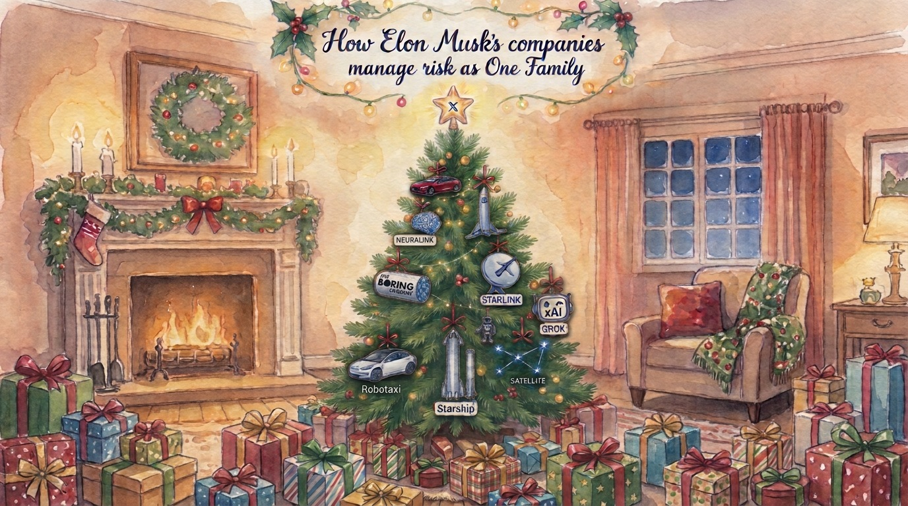

# FIR Risk Tuesday E99

**Publish Date:** December 1, 2026
**URL:** https://firrisk.ai/tuesday/e99-all-under-one-tree/
**Sources:** Tesla, Inc. Form 10-K (fiscal 2025 and 2024), Forms 10-Q (2026 Q1–Q3), current reports (8-K) and quarterly update letters; Space Exploration Technologies Corp. (SpaceX) final prospectus (424B4, June 12, 2026), Forms 10-Q (2026 Q2–Q3), current reports (8-K) and earnings releases; Form D notices of Neuralink Corp. and The Boring Company (2017–2026); Anthropic, PBC Form S-1/A Amendment No. 2 (November 10, 2026) · threading: E97 (The Capacity Race)
**Analysis:** FIR Risk Advisory, from SEC filings retrieved from EDGAR

> DRAFT 1 (11/25) for Bruce's review. Not for publication. Open items are listed under SOURCE DATA → Pending.

---

# FIR Risk E99 — All Under One Tree: How Risk Moves Around Elon Musk's Companies



FIR Risk Advisory | Enterprise Risk Intelligence

*In the third quarter, a tunnel company's fundraising added $561 million to a rocket company's profit. A director's investment firm holds about a third of that rocket company's debt. Its AI assistant can manage a robotaxi rider's inbox. And the robotaxi company's filings and the rocket company's filings describe their CEO's divided time in almost the same sentence.*

*Welcome to the family. We read Tesla's and SpaceX's SEC filings side by side (every risk factor, the latest quarterly reports, every current report since SpaceX's June IPO) plus the private fundraising notices of Neuralink and The Boring Company. Together they show a group of companies that, by its own account, carries less insurance than most, and instead keeps risk inside the family and moves it around. Here is how it works, where the risks converge, and what it means for anyone who depends on them.*

---

## Why read two companies together

In E97 we read big tech's filings as suppliers to everyone else. This edition applies the same lens to a family of companies. Many organizations depend on at least one of them: Starlink for connectivity, Tesla vehicles or Megapack batteries, X, the Grok AI assistant, or SpaceX compute through an AI provider that rents it.

The usual approach scores each supplier on its own. These filings show why that can miss the real exposure. When suppliers share a leader, a lender and each other's products, a problem at one can reach you through another.

This is not investment analysis. We are not commenting on valuations, stock prices or the merits of a combination. We are reading these companies as suppliers and counterparties.

Risk is there to be managed. We work to understand it so organizations can adopt new technology and innovation with their eyes open.

— Bruce, FIR Risk Advisory

---

## Bottom Line

Tesla and SpaceX file separately, but their filings describe one family that manages risk by design: it pools risk under one roof, shares it between companies, finances it from inside, and keeps it rather than insuring it. It also builds the stack itself, from rockets and chips to robots. It works for the family. For everyone who depends on these companies, it means their risks move together: one CEO whose time both list as a risk, one lender with a board seat, shared products, and now two board committees studying a combination. On top of that, SpaceX's fast-growing AI business now gets half its revenue from two customers, on contracts either side can end with 90 days' notice.

**If you depend on more than one Musk company, score them as one concentration, not several independent suppliers.**

---

## The One Sentence Your Board Needs

> Which of our services depend on a Musk company, and would we still be covered if something changed at all of them at once?

Boards don't need a view on Elon Musk or the companies' share prices. They can ask whether the organization knows every route through which it depends on this family (connectivity, vehicles, energy storage, AI tools, and compute behind its AI providers) and whether its continuity plans treat those routes as linked.

---

## 1. How we read the filings

- **Different baselines, compared fairly.** Tesla has filed for years, so we compared its latest annual risk factors (filed January 2026) with the year before, sentence by sentence. Its three 2026 quarterly reports added no new risk factors. SpaceX went public in June 2026, so its baseline is the June prospectus, plus the one risk factor it added in its first quarterly report in August. Its third-quarter report says nothing material changed.
- **Risk factors are only part of the picture.** Several of the most important facts here sit outside the risk factors: in the notes to the accounts, in management's discussion, in earnings releases and in current reports. We say where each one comes from.
- **We report what the filings say.** Where a company doesn't name a customer or a counterparty, we don't guess.

---

## 2. How risk moves around the family

Most companies handle big risks the textbook way: buy insurance, spread suppliers, borrow from banks. Musk's companies mostly do something else. They keep risk inside the family and move it among themselves. They don't hide it, either. Both public companies describe their approach under the same heading, word for word: "Our insurance coverage strategy may not be adequate to protect us from all business risks." The word they chose is *strategy*.

Read the filings together and four moves show up again and again.

**Move 1: Pool it.** In March 2025, xAI and X were combined under one holding company. In February 2026, SpaceX acquired that company. The AI build-out, and X's legal exposure, now sit inside the same company as the rockets and Starlink. SpaceX paid for most of its third-quarter AI build with cash from its June IPO. Pooling formalizes a link that already existed: SpaceX's prospectus describes Brazil freezing Starlink's assets over violations by X, at a time when X "was not owned by us and was only affiliated with Mr. Musk."

**Move 2: Share it.** Each company takes a piece of the others' risks, and of their upside:
- **Tesla as investor.** Tesla agreed in January 2026 to invest $2.0 billion in xAI. After the merger, it holds SpaceX shares worth $2.9 billion at September 30.
- **Tesla as supplier.** SpaceX bought $480 million of Tesla Megapack batteries for its data centers in the first nine months of 2026 (on SpaceX's books), and owed Tesla $729 million at quarter end (on Tesla's). Tesla's update letter says storage demand is "increasingly aligned with SI infrastructure demand."
- **SpaceX as a feature inside Tesla.** Grok runs in Tesla's Cybercab robotaxi, with "access to Grok Bot and Connectors, which allows users to manage their inbox, calendars, files, chats and tasks." Tesla gets an AI assistant; SpaceX gets riders.
- **A joint bet on chips.** Tesla told shareholders that "our partnership with SpaceX aims to build the largest chip fab ever." SpaceX's prospectus says financial terms, intellectual property rights and the term of the collaboration are not finalized.

**Move 3: Finance it inside the family.** Valor Equity Partners, the firm of longtime SpaceX director Antonio Gracias, has financed SpaceX's AI hardware through lease deals that SpaceX accounts for as debt. At September 30 that debt was $12.9 billion, about a third of everything SpaceX owes. It cost $351 million of interest in the third quarter, just over half of SpaceX's interest bill. From 2027, outside money joins in: SpaceX has committed to a GPU lease financing of about $40 billion with an entity managed by Apollo.

**Move 4: Keep it rather than insure it.** Both companies say they "do not maintain as much insurance coverage as many other companies do, and in some cases, we do not maintain any at all." SpaceX doesn't insure its satellites in orbit. It carries no key-person insurance on Musk. Its charter goes further: Musk and his affiliates "are not restricted from owning assets or engaging in businesses that compete directly or indirectly with us," and SpaceX gives up certain business opportunities that come to its directors. The family, not each company, decides where an opportunity lands.

| The move | What the filings show | Who carries the risk |
|---|---|---|
| Pool | xAI and X inside SpaceX; AI build paid from IPO cash | All SpaceX shareholders |
| Share | Tesla's SpaceX stake, Megapacks, Grok in Cybercab, joint chip fab | Tesla and SpaceX, on terms set between related companies |
| Finance | Valor: $12.9B of debt, a director's firm; Apollo from 2027 | Insiders now, outside lenders next |
| Keep | Self-insurance in both; no key-person cover; open corporate opportunities | The companies, and their counterparties |

> **Sidebar: the private side of the family**
>
> Neuralink and The Boring Company are private, so they don't file annual reports. They do file Form D, a short notice each time they raise money privately. It gives amounts, dates, investor counts and officers. It gives no valuations, owners or revenue; both companies decline to state revenue every time.
>
> - **Who owns The Boring Company?** Musk controls it. SpaceX's latest quarterly report says Musk "has a controlling voting interest in TBC." SpaceX owns a stake too. Neither filing gives percentages.
> - **A tunnel company's fundraising lifted a rocket company's profit.** The Boring Company's latest notice reports $3.2 billion raised from 141 investors, with the first sale on August 21, 2026. That is about five times its 2022 round, and the first to include debt. SpaceX marks its stake to the price of new funding rounds, and in the third quarter it booked a $561 million gain "following TBC's completion of new round of financing in September 2026." By our matching of dates, that is this round.
> - **Neuralink** has raised steadily larger rounds: $27 million in 2017, $206 million in 2021, $323 million in 2023 and $649 million in 2025. It hasn't filed a notice since June 2025. In the public companies' filings it appears only as a claim on Musk's time, and no filing describes it buying from Tesla or SpaceX.
> - **The same people show up.** Gracias has sat on SpaceX's board since 2010 and joined the boards of Neuralink and The Boring Company in May 2026. Jared Birchall is listed as an officer and director on every Form D both companies have filed.
> - **Small bills, real ties.** X leases office space from a Boring Company subsidiary. The Boring Company built tunnels for SpaceX in Bastrop, Texas. xAI leases property from Musk Industries LLC, which Musk owns.
>
> The private companies are where the family's risk is hardest to see. Their notices show money raised, not money owed.

**Our read:** this is a deliberate design, and it is effective. Each company gets something from its siblings that most companies buy from outsiders: a customer, an investor, a lender, a supplier or a distribution channel. The family keeps the premiums it would otherwise pay insurers, and it can move capital and opportunities to wherever they earn most. The results are visible in the filings: an AI business that went from $0.8 billion to $7.6 billion of quarterly revenue in a year, built with IPO cash, a director's financing and a sister company's batteries.

The catch is who the design works for. Risk kept inside a family is managed for the family, but it is concentrated for everyone who depends on it. When the companies share a leader, a lender, products and a reputation, they tend to have good years together and bad years together. The money flowing between them is small, about 1% of SpaceX's capital spending in the case of Megapacks. The binding ties are governance and dependency. And when risk moves between related companies, the safeguard is the independent directors, which is why both boards' special committees and SpaceX's limits on shareholder suits matter (section 8).

**What it means for you:** a contract with one of these companies is not isolated from the others. If your organization uses Starlink, Tesla vehicles or energy storage, X or Grok, map them together. Ask what a regulatory action, a boycott or a leadership change aimed at one would do to the rest.

---

## 3. One stack, from rockets to robots

Musk's companies are known for vertical integration: making for themselves what other companies buy. The filings show it is now a family habit, not just a company one, and they show where it creates risk.

**Inside each company.** About 80% of Starship, SpaceX's next rocket, is made in-house, and SpaceX says its "vertical integration allows us to achieve iterative cycles in weeks, compared to years for some legacy companies." For AI, its strategy is "extreme vertical integration, 'from shovels to tokens,'" covering everything "from on-site power generation and water reclamation to GPU deployment." Tesla describes the same habit: it works "at the system level where we identify the limiting factor," building its own batteries, power electronics, software and AI chips, and credits vertical integration for letting it "quickly troubleshoot bottlenecks in production."

**Across the family.** Follow the chain through the filings:
- **Tesla's batteries power SpaceX's data centers**, which are training Grok-5.
- **Grok rides in Tesla's Cybercab** (section 2).
- **Terafab**, the chip fab Tesla and SpaceX plan with Intel, would make two kinds of chips: "one type optimized for terrestrial edge and inference to be used primarily in Tesla's Optimus robots and vehicles, and another type optimized for the space environment to be used in our orbital compute infrastructure."
- **Macrohard**, an AI platform SpaceX is developing "together with Tesla" to emulate office work, aims to "combine our frontier AI model with Tesla's physical AI prowess," running partly on "cost efficient Tesla processors, a critical advantage of our vertical integration." Tesla separately describes "Digital Optimus," aimed at "automating digital workloads." Neither filing says whether these are the same project.
- **Starship would carry the next layer**: next-generation Starlink satellites and computers in orbit.

SpaceX puts the idea in one line: "the future of AI will be determined by the control of the physical stack."

**The rockets: the family's own supplier.** The rocket business is now a small part of SpaceX's revenue and mostly serves the rest of the family:
- **12% of revenue.** The Space segment brought in $1.77 billion in the third quarter, out of $14.6 billion. It lost $7 million from operations, against a $259 million profit a year earlier, as Starship development costs rose 44% to $1.2 billion.
- **Most flights are internal.** Falcon rockets flew 33 times in the quarter, down from 43. Twenty-one carried SpaceX's own payloads, mostly Starlink; 12 carried customers, down from 15. Over nine months, 81 of 110 Falcon launches were internal, and SpaceX classes every Starship launch so far as internal.
- **Internal launches earn no revenue.** Their cost goes onto the balance sheet as part of the satellites. SpaceX says it allocates "a significant amount of launch capacity to our Connectivity segment, and expect[s] to allocate a significant amount to our SI segment in the future."
- **Starship is the first risk on the list.** The first item in SpaceX's risk factor summary: any failure or delay in Starship "would delay or limit our ability to execute our growth strategy, including the deployment of next-generation satellites, global satellite-to-mobile connectivity, and orbital AI compute."

**Optimus: the next product on the line.** Tesla's humanoid robot went from design to factory floor during 2026:
- **The line.** In January, Tesla called Optimus Gen 3 "our first design meant for mass production." In April, it said the first production line, "designed for 1 million robots a year, will replace the Model S and Model X lines in Fremont." By July those car lines were gone. In October: "Optimus production began in Fremont on our high-volume lines," and a second line is under construction in Texas.
- **The money.** Tesla's research spending rose $2.45 billion, or 53%, in the first nine months, partly for "SI and other programs, such as Optimus." Its manufacturing expansion now includes "our semiconductor, Optimus and solar operations."
- **The pay.** "1 million bots delivered" is one of the 12 operational milestones in Musk's 2025 CEO Performance Award. "Optimus production and deployment" is also among the goals behind employee equity awards.
- **The risk factor.** Tesla calls robots "a nascent industry that has yet to develop commercially" and says "there is no guarantee this business will be successful. We have yet to commercialize Bots and cannot predict how demand for Bots will develop." No filing reports Optimus sales yet.

**Our read:** vertical integration is the most effective part of the design. It removes outside bottlenecks and lets the family move fast, and the results show in launch counts and AI revenue. But it moves risk rather than removing it, in three ways:
1. **Internal single points of failure.** A delay in one layer reaches products in another. Starship gates satellites, phone connectivity and orbital compute. Terafab's chips are planned for both Optimus and orbital compute.
2. **Outside suppliers still matter.** SpaceX says: "Although we are focused on the vertical integration of our businesses, we depend on third parties to manufacture and supply certain key components." It buys GPUs on purchase orders, and even with Terafab it expects "to continue sourcing a significant portion of our compute hardware from third-party suppliers."
3. **The family is often its own customer.** When rocket and compute capacity serve Starlink and AI first, outside customers compete with sister businesses for it.

**What it means for you:**
- If you buy launch or compute from SpaceX, ask how your capacity is protected when its own businesses need more, and put priority terms in the contract.
- If you are planning around humanoid robots, treat Optimus as development-stage: in production, but not yet sold, by Tesla's own account.
- Map the stack, not just the vendor. A delay in one layer can show up in a product you buy from another company in the family.

---

## 4. Where the risks converge, and where they don't

We read all 40 of Tesla's risk factors and all 55 of SpaceX's, and grouped them by underlying cause. The difference in length says something on its own:

| | Tesla | SpaceX |
|---|---|---|
| Risk factors | 40 | 55 |
| Words | about 12,600 | about 30,000 |
| Risk factor on Musk as a key person | 92 words | 585 words |
| Names the other company | Once, as a claim on Musk's time | In four risk factors: the chip project, the Macrohard AI collaboration, unfinished terms, and Musk's role at Tesla |
| Separate risk factor on AI compute | None (AI runs through six others) | Yes, plus a new one in August on customer concentration |

**Where they converge: the same root cause**

1. **Musk's divided time.** Each company's risk factors name the other as a competing demand on Musk, in almost the same words: although he "is highly active in our management, he does not devote his full time and attention to" the company. Tesla's version runs 92 words; SpaceX's runs 585.
2. **Musk's stake.** Tesla warns he may "be required to sell shares of our common stock" to fund other ventures. SpaceX says he "will not be subject to any obligation to maintain his ownership interest." Tesla adds that its 2025 CEO pay award may steer the company toward products "misaligned with current or future consumer demand."
3. **AI compute and power.** Tesla says AI "demands exponentially greater compute, memory, energy and thermal resources, which may prove insufficient in scale or affordability." SpaceX buys "all of our GPUs on a purchase-order basis," with no long-term contracts with its chip suppliers, and powers its data centers largely with gas turbines that face permit lawsuits in Mississippi.
4. **Concentrated supply and tariffs.** Both rely on single-source or sole-source suppliers, and both name tariffs.
5. **Cyber risk to the physical product.** Tesla describes attempts to "gain control of, or to change, our products' functionality." SpaceX says a cyberattack could disable enough satellites to "trigger a cascading collision event." Both say incidents have already happened.
6. **Insurance.** The two filings share this heading word for word: "Our insurance coverage strategy may not be adequate to protect us from all business risks." Both say they "do not maintain as much insurance coverage as many other companies do, and in some cases, we do not maintain any at all." SpaceX does not insure its satellites in orbit.

**Risks unique to Tesla**
- Liability and regulation for driver assistance and Robotaxi, under rules that were "drafted assuming the presence of a human driver."
- Demand that depends on government incentives, some of which "have expired or were cancelled."
- Customer financing, resale values and credit.
- The CEO pay plan as a strategy risk.
- Fleet-scale recalls and union activity.

**Risks unique to SpaceX**
- Liability for AI-generated content: Grok's "'Spicy' Imagine Mode and 'Unhinged' Voice Mode," and investigations into AI images of children.
- Space debris and uninsured satellites, and anti-satellite weapons.
- Asset seizure triggered by an affiliate's conduct (Brazil).
- Limits on shareholders: a suit on the company's behalf needs holders of 3% of the shares, which SpaceX values at about $53 billion, plus mandatory arbitration and no class actions.
- AI revenue from a few customers who can leave on 90 days' notice (next section).

**Our read:** the risks converge where the cause is shared: one leader, scarce compute and power, concentrated supply, connected fleets, and a habit of carrying risk rather than insuring it. They split where the businesses differ: Tesla's are about cars on public roads and consumer demand, SpaceX's about space, AI content and control. The identical insurance wording suggests a shared approach to risk across the family.

**What it means for you:** if a Tesla or SpaceX product fails and causes damage, recovery depends on the company's balance sheet and your contract, not an insurer. Check indemnity caps and your own cover. And treat a Starlink terminal, a Tesla vehicle or a Megapack on your premises as connected operational technology, updated remotely by a vendor you don't control.

---

## 5. Half of SpaceX's revenue comes from two customers

SpaceX's AI segment (it calls it "SI," for super intelligence) grew from $0.8 billion of revenue in the third quarter of 2025 to $7.6 billion a year later, mostly from renting computing capacity. That changed the company's customer base.

- **Two customers, 51% of revenue.** In the third quarter, "Customer B" provided 34.5% of SpaceX's revenue, about $5.0 billion by our math, all from the AI segment. A year earlier it was below 10%. "Customer A," which buys across all three segments, provided 16.6%. One customer accounted for 27.7% of what SpaceX was owed at quarter end.
- **Short exits.** SpaceX's cloud contracts are "typically three years and terminable by either party upon 90 days' notice." Its August risk factor warns that "a significant portion of our AI infrastructure revenue is concentrated in a small number of customers."
- **Long commitments on the other side.** SpaceX has $37.8 billion of non-cancelable commitments, $25.6 billion of them due in 2027, mostly for AI infrastructure, third-party cloud capacity and a spectrum purchase. Its prospectus says it has "non-cancellable, multi-year capacity commitments to cloud compute providers, requiring payment regardless of usage."

**Who are the customers?** SpaceX names neither. The only cloud customer it names is Anthropic. Its prospectus describes agreements signed in May 2026 for capacity across its COLOSSUS and COLOSSUS II data centers in Memphis, Tennessee and Southaven, Mississippi, "approximately 325,000 NVIDIA GPUs," at "$1.25 billion per month through May 2029."

Anthropic's own IPO filing gives the other side of the contract:

> "Between May and October 2026, we entered into and amended several agreements with SpaceX.AI LLC … Under the SpaceXAI Arrangements, we agreed to spend an aggregate of up to $120.5 billion over terms extending into 2029, consisting of approximately $3.1 billion in the aggregate per month once all capacity has been delivered, which we expect in December 2026."

At full capacity that is more than $9 billion a quarter. SpaceX's total revenue in the third quarter was $14.6 billion. After initial periods that end in January and March 2027, either side can cancel on 90 days' notice. No filing says whether Customer B is Anthropic, and we don't assume it.

*Disclosure: FIR Risk uses AI models from several providers, including Anthropic.*

**Our read:** this is the race we described in E97, seen from the seller's side. SpaceX is paying for capacity years in advance while its largest buyers can leave within months. Both sides of the Anthropic arrangement describe the same 90-day exit, so the flexibility runs both ways. It also shows how concentrated the market has become. One AI company's computing contract, signed for a few years, can be large enough to reshape a supplier's revenue.

**What it means for you:** your AI provider's computing power may come from someone else's data center, under terms that can change within a quarter. Ask your critical AI providers where their capacity comes from, how much depends on a single supplier, and what notice they would get, and give you, if it changed.

---

## 6. Paying for the race

**SpaceX** spent $48.1 billion on capital projects in the first nine months of 2026, up from $13.8 billion a year earlier. $40.0 billion of it went to the AI segment. Most of the third quarter was paid from the cash raised in the June IPO: total debt stayed at about $38.0 billion, while cash and marketable securities fell by about $10 billion. In October, SpaceX committed to a lease financing of about $40 billion for GPU equipment with an entity managed by Apollo, starting in the first half of 2027.

The wording on financing also changed. In August, SpaceX said that if its data center needs "decrease in scale or ramp more slowly than expected ... we may reduce future capital expenditures in this segment." That sentence is gone from the third-quarter report. In its place: "There can be no assurance that additional financing will be available in amounts or on terms acceptable to us, if at all."

**Tesla** is spending heavily too, but from a stronger cash position. Capital spending was $13.0 billion in the first nine months, up from $6.1 billion. It raised its 2026 guidance from more than $20 billion to more than $25 billion in the spring, then lowered it back to more than $20 billion in October. In September it signed $30 billion of bank credit lines, and said it "does not currently plan to draw on the facilities in 2026." Cash and investments were $45.4 billion at September 30. In the third quarter, Tesla relabeled its AI spending as "SI," the same term SpaceX uses.

**Our read:** both companies are building AI capacity at a pace their own history doesn't match. SpaceX is funding it with IPO cash now and leases from next year, and has dropped the sentence that described how it could slow down. Tesla is keeping its credit lines in reserve.

**What it means for you:** if you rely on SpaceX for compute, connectivity or launch, add its commitments and financing to your supplier reviews. Its own filings say capacity can be reprioritized: the prospectus lists "prioritization of internal versus external compute usage" as a risk.

---

## 7. AI liability is in court

SpaceX's AI legal exposure has grown since the prospectus:
- **Grok image cases.** Multiple lawsuits since January 2026 allege Grok's image features enabled nonconsensual explicit images, and a motion asks to consolidate them in one federal court. Virginia's attorney general sent a notice of violation in October.
- **EU fine.** The European Commission fined X, its parent companies and Musk €120 million under the Digital Services Act. They are appealing.
- **The data centers.** A Clean Air Act suit challenges the gas turbines powering COLOSSUS II; the US government has moved to intervene to dismiss it. Mississippi regulators are seeking up to about $6.1 million in stormwater penalties. A Memphis contractor claims about $569 million in liens for unpaid work, in a dispute SpaceX's AI companies started.
- SpaceX has set aside $350 million for litigation losses it considers probable; it gives no estimate for the Grok cases.

**Tesla's** filings list product-liability, securities and consumer suits over driver assistance and Robotaxi, and information requests from regulators. They name no specific regulatory investigation.

**What it means for you:** if your staff use Grok or X, or your vehicles carry Grok with access to email and calendars, treat it as an AI vendor with open legal questions about content and data. Put it through the same third-party review as any other AI tool connected to your systems (see INTEL-67).

---

## 8. What the risk factors don't say yet

- **A possible combination.** In October, both boards formed special committees to evaluate it. SpaceX: "our board of directors has formed a special committee to evaluate a potential combination between SpaceX and Tesla, Inc." Any deal would also need the approval of "our controlling shareholder." Neither company has added a risk factor about it. It appears only in the quarterly reports.
- **Tesla's side of the family.** Tesla's risk factors never mention the chip project, the AI collaboration or its SpaceX shares. Tesla hasn't added a risk factor since January, before those were disclosed. SpaceX names Tesla in four.
- **Thinner outside oversight at SpaceX.** Musk controls the majority of votes, SpaceX uses the exemptions available to controlled companies, and it says its internal controls "currently do not meet all of the standards" of Section 404 of the Sarbanes-Oxley Act.
- **What December brings.** Tesla's annual meeting is on December 3. The resale restrictions on Tesla's SpaceX shares, tied to the IPO, expire in December. The committees have set no date.

**Our read:** the two companies are becoming more entangled faster than their risk factors describe. To track the family, read the notes, the quarterly reports and the current reports, not the risk factors alone.

---

## So What Should Organizations Actually Do?

None of this means avoiding these companies. Their products lead in several markets, and many organizations depend on them for good reasons. The point is to manage the dependency as what it is: a family. Six lines for your risk register:

**Now: map the family**

1. **One concentration.** List every service you take from a Musk company (Starlink, Tesla vehicles or energy storage, X, Grok) and score them together for continuity, reputation and regulatory risk.
2. **AI tools with access.** Where Grok or similar assistants connect to email, calendars or files, including in vehicles, include them in your third-party risk program and review them after onboarding, not only before.

**Next: build it into contracts and reviews**

3. **Your AI provider's suppliers.** Ask critical AI providers where their compute comes from, how concentrated it is, and what notice terms apply on both sides.
4. **Exit terms.** Where you buy capacity or services on short notice terms, plan for the supplier to use them too. Ninety days is not long to move an AI workload.
5. **Self-insured suppliers.** Check indemnity caps and your own insurance for damage from products whose makers carry the risk themselves.

**Future: watch the governance**

6. **The combination.** Track the special committees and any change of control. A combination would change counterparties, contracts and concentration for every customer of both companies.

The two companies file separately. Their risks don't stay separate. The best use of these filings is to make sure your own risk register doesn't treat them as strangers.

**Coming next:** NVIDIA, the chip supplier behind most of this capacity, including SpaceX's 325,000 GPUs.

---

## Learn More

- [Tesla Form 10-K, fiscal year ended December 31, 2025](https://www.sec.gov/) (link TO DO)
- [Tesla Form 10-Q, quarter ended September 30, 2026](https://www.sec.gov/) (link TO DO)
- [SpaceX final prospectus (424B4), June 12, 2026](https://www.sec.gov/) (link TO DO)
- [SpaceX Form 10-Q, quarter ended September 30, 2026](https://www.sec.gov/) (link TO DO)
- [Anthropic, PBC Form S-1/A Amendment No. 2, November 10, 2026](https://www.sec.gov/Archives/edgar/data/2130357/000162828026072484/anthropicpbc-sx1ax2.htm)
- [FIR Risk Tuesday E97 — The Capacity Race](/tuesday/e97-the-capacity-race/) — big tech's risk disclosures and the race for AI capacity
- [FIR Risk INTEL-67 — The Review Can't Stop at Onboarding](/intel/intel-67-the-review-cant-stop-at-onboarding/) — AI tools and connectors as vendors (slug TO CONFIRM)

---

Stay forward. Stay positive. Stay verified.

— FIR Risk Advisory

Find all editions on firrisk.ai: https://firrisk.ai/tuesday/

# LINKEDIN POST

```
A tunnel company raised money, and a rocket company's profit went up $561 million.

That's one of the stranger facts in Elon Musk's companies' SEC filings. We read Tesla's and SpaceX's side by side, plus the private fundraising notices of Neuralink and The Boring Company.

What we found: a family of companies that manages risk by design. It keeps risk inside and moves it around.

→ Pool it: xAI and X now sit inside SpaceX, alongside rockets and Starlink.
→ Share it: Tesla owns $2.9B of SpaceX stock and sells it Megapacks; SpaceX's Grok runs inside Tesla's Cybercab, with access to riders' inbox and calendar.
→ Finance it inside: a SpaceX director's firm holds $12.9B of SpaceX debt, about a third of the total. He joined Neuralink's and The Boring Company's boards in May.
→ Keep it: both companies use the identical heading, "Our insurance coverage strategy may not be adequate."
→ Build it in-house: about 80% of Starship is made in-house, 81 of 110 Falcon launches this year carried SpaceX's own payloads, and the planned chip fab would make chips for Tesla's Optimus robots and for computers in orbit.

It works for the family. For everyone who depends on them, it means the risks move together. And two customers now make up 51% of SpaceX's revenue, on contracts either side can end with 90 days' notice.

Not investment advice. A supplier risk question: if you depend on more than one Musk company, score them as one concentration.

The question for every board: which of our services depend on a Musk company, and would we still be covered if something changed at all of them at once?

#TechnologyRisk #ThirdPartyRisk #AIRisk #RiskManagement #EnterpriseRisk #CISO #Boards
```

## X POST

A tunnel company raised $3.2B. A rocket company booked a $561M gain.

Musk's companies don't buy much insurance. They keep risk in the family: pooled, shared, financed by a director's firm, self-insured. Both filings even call it a "strategy."

We read how it works.

Full edition → FIR Risk Tuesday E99

#ThirdPartyRisk #AIRisk

---

## SOURCE DATA

**Editorial Frame:**
Bruce 11/26: highlight Musk's design as a fact observation, not promotion: "by design is pooling, sharing, transfering, and retaining risk internally rather than insuring"; asked to research the private companies via Form D and to make the edition "extra interesting". Section 2 reworked to "How risk moves around the family" with the private-side sidebar; new hook in the standfirst and social.
Bruce 11/24: ELON Tue 12/1 (Christmas theme), NVIDIA Tue 12/8. Frame (as E97): what changed in disclosed risk and what it means for the reader's risk register; not investment commentary. Bruce 11/25 approved the ONE FAMILY theme ("much better"), asked for concentration (who are the two customers) and for a risk-factor section showing convergence vs uniqueness ("Our readers will want to understand the risk side of the companies"). Bruce 11/25: outline approved ("very solid outline").
Christmas theme carried lightly by the title ("All Under One Tree" = one family); no holiday statistics claimed.

**Method:** Tesla Item 1A FY25 10-K vs FY24 10-K, diffed paragraph by paragraph (rf/tesla_10K_diff.txt; 51 changed paragraphs); 2026 10-Qs add none. SpaceX: 424B4 risk factors (pp. 28–65) + one added in Q2 10-Q (p.51); Q3 10-Q "no material changes" (p.57). Risk factors counted by heading and grouped by root cause (research/rf_matrix.md, 17 rows, every quote with line + printed page). Word counts are FIR's count of extracted text, page footers excluded.

**Fact-Check Notes (page = printed page; files in reports/elon-2026q3/):**
- Musk time: Tesla 10-K FY25 p.19 "Although Mr. Musk spends significant time with Tesla and is highly active in our management, he does not devote his full time and attention to Tesla" + names SpaceX, xAI, Neuralink, Boring Co. SpaceX 424B4 p.59 "is highly active in our management, he does not devote his full time and attention to our businesses"; Musk "Technoking and Chief Executive Officer of Tesla"; "We do not maintain key-person life insurance on Mr. Musk." Both sentences open with "although" (Tesla "Although Mr. Musk spends significant time"; SpaceX "although Mr. Musk devotes significant time", L3482), checked 11/25.
- Musk stake: Tesla 10-K p.26 "be required to sell shares of our common stock in satisfaction of such commitments"; 2025 CEO award heading "misaligned with current or future consumer demand" (p.26). SpaceX 424B4 p.60 "will not be subject to any obligation to maintain his ownership interest in us".
- Compute/power: Tesla 10-K p.13 "demands exponentially greater compute, memory, energy and thermal resources, which may prove insufficient in scale or affordability". SpaceX 424B4 p.38 "procuring all of our GPUs on a purchase-order basis"; p.38 gas turbines; p.49 Southaven turbine suits; p.39 "non-cancellable, multi-year capacity commitments to cloud compute providers, requiring payment regardless of usage"; p.55 "prioritization of internal versus external compute usage".
- Supply: Tesla p.13 single-source + 2025 tariffs; SpaceX p.37 sole or limited-source.
- Cyber: Tesla p.20 "gain control of, or to change, our products’ functionality"; p.19 service-provider ransomware. SpaceX p.36 "trigger a cascading collision event"; p.41 past incidents.
- Insurance: identical heading Tesla p.21 / SpaceX p.58 (spot-checked 11/25); identical sentence "we do not maintain as much insurance coverage as many other companies do, and in some cases, we do not maintain any at all" (Tesla p.21, SpaceX p.58); SpaceX in-orbit satellites uninsured p.58.
- Tesla unique: "drafted assuming the presence of a human driver" p.24; incentives "have expired or were cancelled" p.23; financing p.17–18; CEO award p.26; recalls/unions pp.20–21.
- SpaceX unique: "“Spicy” Imagine Mode and “Unhinged” Voice Mode" p.32; investigations into images of children p.32; anti-satellite p.45; Brazil "was not owned by us and was only affiliated with Mr. Musk" p.45; "3% of our outstanding shares has a total dollar value of approximately $53 billion" p.62; arbitration/Texas Business Court pp.63–65; Section 404 "currently do not meet all of the standards" p.57; majority voting control p.61.
- Size table: Tesla 40 headings, 12,598 words, pp.12–26; SpaceX 54 + 1 = 55, ~29,966 words, pp.28–65; Musk factor 92 vs 585 words. Cross-naming: SpaceX names Tesla in 4 risk factors (pp.38, 52, 58, 59); Tesla once (p.19); "Terafab"/"Macrohard" 0 hits in Tesla 10-K + 2026 10-Qs.
- Valor: SpaceX Q3 10-Q Note 17 L927 p.31: Gracias is a director; debt $2,181M current + $10,716M non-current = $12,897M; $351M interest Q3. [computed] 33.9% of total debt principal $38,006M (p.17); 52% of Q3 interest expense $675M (Q3 release). Not in risk factors.
- Megapacks: SpaceX's books, purchases $151M Q3 / $480M 9M (SpaceX Q3 10-Q L926 p.31). Tesla's books: revenue $221M Q3 / $626M 9M; receivable $729M and deferred revenue $648M include $588M billed for undelivered units (Tesla Q3 10-Q p.28). Text uses SpaceX's figure and says the books differ.
- Grok in Cybercab: Tesla Q3-26 update letter (8-K Ex.99.1), slide 8: "Grok is available in Cybercab with access to Grok Bot and Connectors, which allows users to manage their inbox, calendars, files, chats and tasks". Quoted from "access".
- Chip fab: Tesla Q1-26 update letter slide 8 "Our partnership with SpaceX aims to build the largest chip fab ever". SpaceX 424B4 p.58 "have not finalized a variety of details relating to our collaboration, including, but not limited to, financial terms, intellectual property rights, and the ultimate term" (text elides "but not limited to"); p.38 "neither Tesla nor Intel are obligated to remain a part of the project".
- Tesla SpaceX stake: Tesla Q3 10-Q p.28 "$ 2.00 billion in SpaceX common stock (formerly a preferred share investment in xAI)", March 2026; fair value $2,865M; resale restrictions "expire in December 2026" (L525 p.16).
- Boring Co: SpaceX Q3 10-Q L558 p.17 / L931 p.32, $561M unrealized gain, Q3.
- Capex: SpaceX 9M $48,069M vs $13,846M (Q3 10-Q p.9); SI $39,995M vs $8,077M (segment table p.32); text "$40.0 billion" = $39,995M rounded. Debt principal $38,006M (p.17), flat vs 6/30 (~$38.0B). Cash + marketable securities $89,855M at 9/30 vs $100,009M at 6/30 (Q3 10-Q p.52; Q2 10-Q p.47) [computed −$10.2B].
- Apollo: SpaceX 8-K 10/26/2026, master finance lease, ~$40B aggregate principal, commencing H1 2027.
- Off-ramp removed: Q2 10-Q p.47 "decrease in scale or ramp more slowly than expected ... we may reduce future capital expenditures in this segment"; absent in Q3. Q3 10-Q p.52 "There can be no assurance that additional financing will be available in amounts or on terms acceptable to us, if at all."
- Concentration: SpaceX Q3 10-Q L446–450 p.13: Customer B 34.5% (Q3'25 below 10%, "*"), Customer A 16.6%; A "all three segments", B "SI segment"; one customer 27.7% of accounts receivable. Q2: B 19.5% (Q2 10-Q p.14). [computed] B ≈ $5.03B; A+B = 51.1%. SI segment revenue $7,560M vs $813M (p.13). Revenue $14,575M (p.5).
- Contract terms: Q3 10-Q L1203 p.42 "typically three years and terminable by either party upon 90 days’ notice". Q2 10-Q risk factor p.51 "a significant portion of our AI infrastructure revenue is concentrated in a small number of customers".
- Commitments: Q3 10-Q pp.28–29 $37,840M, 2027 $25,569M; "SI infrastructure and third-party cloud capacity arrangements"; includes Spectrum Transaction.
- Anthropic (SpaceX side): 424B4 p.14 (L1138–1148) "COLOSSUS and COLOSSUS II", "approximately 325,000 NVIDIA GPUs", "$1.25 billion per month through May 2029"; also F-63. COLOSSUS = Memphis; COLOSSUS II = Memphis + Southaven MS (424B4 L287–289).
- Anthropic (own side): S-1/A No. 2 p.180 (bigtech-ai-2026q3/filings/text/anthropic_s1a2.txt L10420–10427), quoted; "Following initial non-cancelable periods ending in January 2027 and March 2027 ... may be cancelled by either party upon 90 days’ advance written notice." [computed] $3.1B × 3 = $9.3B/quarter.
- Customer identity: NO filing says Customer B = Anthropic. Text states the two disclosed facts side by side and says so.
- Tesla financing: capex 9M $13.01B vs $6.13B (Q3 10-Q p.30); guidance >$20B (10-K p.33) → >$25B (Q1 10-Q p.30, Q2 10-Q p.30) → >$20B (Q3 10-Q p.33); credit 8-K 9/29: $20B DDTL + $8B + $2B revolvers, "does not currently plan to draw on the facilities in 2026"; cash and investments $45,447M (Q3 update letter slide 4); AI → SI relabel (Q2 10-Q p.17 vs Q3 10-Q p.17).
- Litigation (SpaceX Q3 10-Q Note 16, pp.29–31): Grok suits since January 2026 + consolidation motion (L916 p.30); Virginia AG notice of violation 10/19 (L919 p.31); EU DSA EUR 120M on XIUC, X Corp., X.AI Holdings and Musk, challenged (L907 p.29); NAACP Clean Air Act, "The United States has moved to intervene to dismiss the action" (L920 p.31); MDEQ ~$6.1M (L1527 p.57); contractor liens "approximately $ 569 million" (L922 p.31); accrual $350M (L923 p.31).
- Tesla litigation: Q3 10-Q p.26 securities/product/consumer suits; p.27 information requests on "Advanced Driver-Assistance Systems and Robotaxi"; no NHTSA probe named.
- Combination: Tesla Q3 10-Q Item 5 p.41; SpaceX Q3 10-Q L1111 p.38 (quoted, incl. "our controlling shareholder"); not in either Item 1A; not in SpaceX prospectus (IPO 4 months earlier); Tesla proxy (10/19) does not mention it.
- Tesla annual meeting December 3, 2026 (DEF 14A).
- Section 2 (11/26 rework): xAI and X under X.AI Holdings March 2025; acquired by SpaceX February 2, 2026 (Tesla DEF 14A L5338; 424B4 p.55 "We acquired xAI in February 2026"). Tesla's $2.0B agreed January 2026 (Tesla Q3 10-Q p.28). "Energy storage demand is increasingly aligned with SI infrastructure demand" (Tesla Q3-26 update letter, L12). Musk "not restricted from owning assets or engaging in businesses that compete directly or indirectly with us" (424B4 p.58); corporate-opportunity renunciation (424B4 p.59). No key-person insurance (424B4 p.59). Gracias SpaceX director "since October 2010" (424B4 L10408 p.228). Megapacks $480M vs capex $48,069M = 1.0% [computed]. SI revenue $813M → $7,560M (Q3 10-Q p.13).
- Sidebar (research/private_cos_formd.md; raw XML filings/formd/): TBC Form D accession 0001737630-26-000003 filed 2026-09-10, first sale 2026-08-21, $3,198,599,250 sold of $3,420,699,200, 141 investors, equity + debt + options/warrants, directors Akis, Gracias, Hering; 2022 round $675,285,773 (38 investors) [computed 4.7x, "about five times"]. Musk "controlling voting interest in TBC"; SpaceX "holds certain equity interests in TBC"; $561M gain "following TBC's completion of new round of financing in September 2026" (SpaceX Q3 10-Q L931 p.32; L558 p.17). Round = gain is OUR date match (10-Q doesn't cite the Form D); text says "By our matching of dates". Neuralink Form D: 2017 $26,958,000; 2021 $205,899,985; 2023 D/A $323,241,676; 2025 $649,000,093; none since 2025-06-12. Gracias boards Neuralink + TBC since May 2026 (424B4 L10411–10412 p.228). Birchall listed officer + director on all 10 notices. X lease from TBC subsidiary, SpaceX Bastrop tunnels $1M 2025 (424B4 L11353–11356 p.245); Musk Industries LLC lease to xAI (L11357 p.245). Revenue "Decline to Disclose" on all 10.

**Section 3 (added 11/26, Bruce asked for Optimus, vertical integration and rockets; renumbered old 3–7 to 4–8):**
- SpaceX 424B4 p.163: "approximately 80% of Starship ... is manufactured in-house"; "Our vertical integration allows us to achieve iterative cycles in weeks, compared to years for some legacy companies." p.96: "our strategy is extreme vertical integration, “from shovels to tokens.”" p.133: "full vertical integration from on-site power generation and water reclamation to GPU deployment." p.146 (also p.155): "the future of AI will be determined by the control of the physical stack." p.14: Grok-5 "currently being trained at COLOSSUS II".
- Terafab two-chip quote: 424B4 p.146. Macrohard "Together with Tesla, we are also developing Macrohard": p.145 (also p.8, p.85); "combine our frontier AI model with Tesla's physical AI prowess" and "cost efficient Tesla processors, a critical advantage of our vertical integration": p.171.
- Tesla Q4 2025 update letter (8-K 1/28/26, overview): "at the system level where we identify the limiting factor"; "quickly troubleshoot bottlenecks in production"; Robotics: Gen 3 "our first design meant for mass production". Q1 2026 letter (8-K 4/22): first-generation line "designed for 1 million robots a year, will replace the Model S and Model X lines in Fremont"; "Digital Optimus ... automating digital workloads". Q2 letter (8-K 7/22): "We have decommissioned the manufacturing lines for Models S & X at our Fremont Factory". Q3 letter (8-K 10/21): "Optimus production began in Fremont on our high-volume lines"; capacity table "Texas Optimus - Construction". Letter page numbers not reliable in extracted text; cited by letter and section.
- Tesla Q3 10-Q p.36: R&D +$2.45B / 53% (9M) "SI and other programs, such as Optimus"; p.30: "our semiconductor, Optimus and solar operations"; p.22: operational milestone 3 "1 million bots delivered" (2025 CEO Performance Award). Proxy p.37: "Optimus production and deployment" among employee equity goals. FY25 10-K p.15: "a nascent industry that has yet to develop commercially"; p.16: "there is no guarantee this business will be successful. We have yet to commercialize Bots and cannot predict how demand for Bots will develop." "No filing reports Optimus sales yet" = absence in our filings, not a company statement.
- SpaceX Q3 10-Q p.39: Falcon launches 33 vs 43 (customer 12 vs 15, internal 21 vs 28); 9M 110 vs 124 (customer 29 vs 36, internal 81 vs 88); Starship 2 vs 1 (Q3), 3 vs 4 (9M); "To date, all Starship launches have been classified as internal." Mass to orbit 476 t vs 525 t (not used). p.40: Starlink launch costs capitalized, no inter-segment revenue; "expect to allocate a significant amount to our SI segment in the future". p.46: Space revenue $1,767M vs $1,666M; R&D $1,225M (+44.3%) for Starship; operating loss $(7)M vs $259M income; 12% = $1,767M / $14,575M (our math).
- Risk factors: 424B4 p.16 summary first bullet (Starship); p.37 "Although we are focused on the vertical integration of our businesses, we depend on third parties to manufacture and supply certain key components"; p.38 "continue sourcing a significant portion of our compute hardware from third-party suppliers".
- Not claimed: that Digital Optimus = Macrohard; that Grok runs in Optimus; that customer-launch decline is caused by internal demand (presented side by side only).

**FIR synthesis (not company claims), labeled "Our read" in text:** the four moves (pool, share, finance, keep) as FIR's classification; "vertical integration is the most effective part of the design" and the three ways it moves risk (section 3); "the family is often its own customer"; "a deliberate design, and it is effective" (supported by the companies' own word "strategy", the charter's corporate-opportunity terms and board-approved transactions; intent beyond that not claimed); "managed for the family, concentrated for everyone who depends on it"; the family frame; "governance and dependency, not money"; the shared approach to risk inferred from identical insurance wording; the two-sided 90-day flexibility; "more entangled faster than their risk factors describe".

**NOT USED:** Neuralink using Grok or SpaceX compute (no source); ownership percentages (not disclosed); Birchall's role outside the Form Ds (not in our filings); any guess at the identity of Customer A or B; stock-price, valuation or lock-up market commentary; Tesla total revenue % for Megapacks; NHTSA probes (not in Tesla filings); Cursor acquisition details; Valor 10b5-1 distribution plan; EchoStar spectrum detail beyond "spectrum purchase"; "Senior Advisor to the President" reference.

**Disclosure:** Claude (Anthropic) drafted this analysis; FIR Platform uses Anthropic models. Section 5 quotes Anthropic's own filing about its SpaceX compute contract. ⚠ Bruce to double-check that passage (Anthropic rule) and decide on the in-text disclosure line (placed as in E97).

**Pending:**
- Bruce's review of draft 1.
- Cross-check with the FIR Risk Agent once Bruce's platform ingest of TSLA/SPCX filings is complete.
- EDGAR links for Learn More; confirm INTEL-67 slug.
- Hero image `images/e99-all-under-one-tree.jpg` (Bruce); no company logos.
- Edition number E99 assumed (E98 = SIGNALS 11/17).
