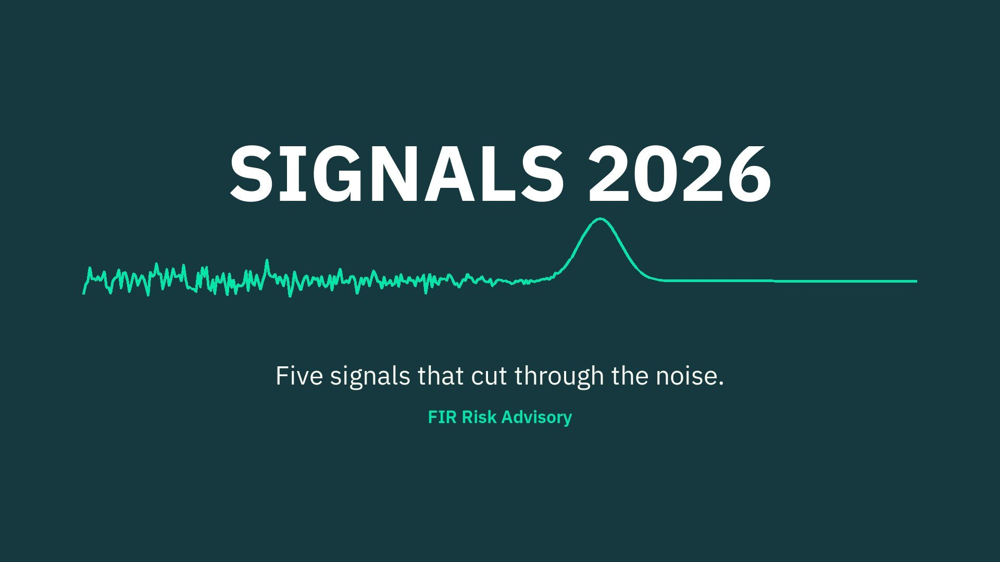

# SIGNALS 2026: Early Release, the 2 PM Friday-the-13th Blues

Special social post, Friday 11/13/2026, 2 PM MT. Sneak peek of SIGNALS 2026 (published on firrisk.ai that morning).

**URL:** https://firrisk.ai/reports/signals-2026/



---

# LINKEDIN POST

```
👻 EARLY RELEASE: The 2 PM Friday-the-13th Blues

It's Friday the 13th. It's 2 PM. Something is creeping up on your afternoon, and it isn't the weekend.

Consider this your early release.

This morning we published SIGNALS 2026, our annual report for CEOs and boards. We read two years of threat reports, checked every number at the source, and kept only the five signals that independent sources agree on.

Here's your sneak peek, if you dare:

🕯️ 01 · The window is gone. The fastest eCrime breakout CrowdStrike recorded took 27 seconds. You can't out-patch that. Expose less.

🎭 02 · Inside, they look like you. 82% of the intrusions CrowdStrike detected in 2025 used no malware. Just stolen logins and normal-looking activity.

🚪 03 · Half of breaches now involve a third party. 48%, up from 9% three Verizon DBIR editions ago. The call is coming from inside your vendor list.

⏳ 04 · Recovery time sets the bill. 69% of ransomware victims refused to pay, so attackers now go after your ability to recover.

🪞 05 · Your own AI is the risk you control. 45% of employees use AI at work, and 67% of AI users sign in with personal accounts.

And a little light before dark: the basics still work. MFA blocks more than 99% of unauthorized sign-in attempts.

Beat the Friday blues:
▶️ Watch or listen to the 10-minute narrated edition
📄 Download the free PDF for the details, including an appendix that maps all five signals to MITRE ATT&CK and ATLAS techniques and mitigations for your security team

No sign-up. No paywall. Nothing hiding under the bed.

#FridayThe13th #CyberRisk #BoardGovernance #RiskManagement #CISO #ThirdPartyRisk #AIGovernance #Ransomware #MITREATTACK
```

## X POST

👻 EARLY RELEASE: The 2 PM Friday-the-13th Blues

SIGNALS 2026 went live this morning. Two years of threat reports, every number checked at the source, five signals that held up.

A sneak peek, if you dare:

01 The window is gone. Fastest eCrime breakout: 27 seconds.
02 Inside, they look like you. 82% of intrusions used no malware.
03 Half of breaches involve a third party. 48%, up from 9%.
04 Recovery time sets the bill. 69% of ransomware victims refused to pay.
05 Your own AI is the risk you control. 67% of AI users sign in with personal accounts.

The good news: MFA still blocks 99%+ of unauthorized sign-ins.

Watch or listen to the 10-minute narrated edition, then grab the free PDF. It maps all five signals to MITRE ATT&CK and ATLAS. Link below 👇

#FridayThe13th #CyberRisk

---

# SOURCE DATA

All figures from SIGNALS 2026 (https://firrisk.ai/reports/signals-2026/), each checked at its primary source there: CrowdStrike Global Threat Report 2024–2026 (27 s, 82%); Verizon DBIR 2024–2026 (48% vs 9%, 69%, 45%, 67%); Microsoft Digital Defense Report 2025 (MFA >99%).
